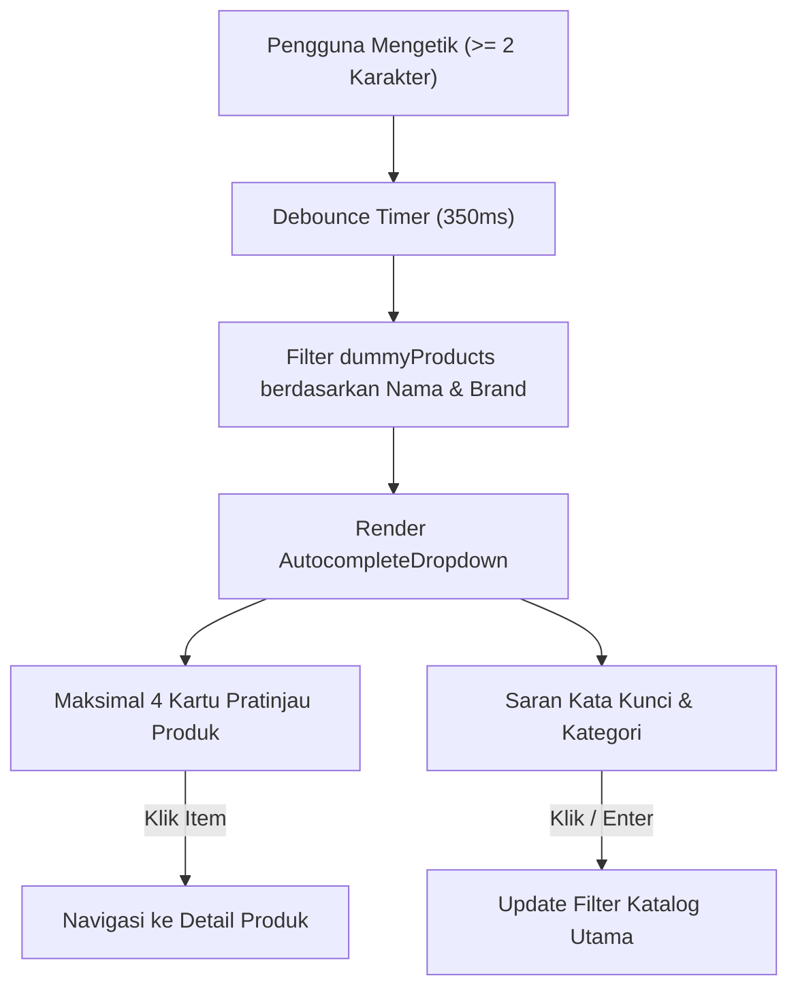

# PANDUAN IMPLEMENTASI TEKNIS — FASE 2: UNIFIED SEARCH & AUTOCOMPLETE
## Calosa Laptop & Gadget Store (Web Catalog & Comparison Experience)

Dokumen ini berisi panduan teknis langkah demi langkah (*step-by-step implementation guide*) beserta seluruh kode komponen dan instruksi eksekusi untuk **Fase 2** berdasarkan **PRD v2.0** (`FR-01`, `AC-01`, `UX-01`, `UX-02`).

---

## 🎯 Tujuan & Cakupan Fase 2

Pada fase ini, kita menyelesaikan salah satu masalah utama yang ditemukan dalam riset pengguna (Worksheet 1 & Responden R1–R5):
1. **Menghilangkan Duplikasi Search Bar:** Memastikan hanya ada **satu kotak pencarian terpadu (*Unified Search Bar*)** di *header* aplikasi yang konsisten di semua halaman.
2. **Autocomplete & Pratinjau Instan:** Menampilkan saran kata kunci dan **maksimal 4 pratinjau produk** (gambar/placeholder, nama produk, kategori, dan harga) saat pengguna mengetik $\ge 2$ karakter dengan *debounce* $300\text{ms}$–$400\text{ms}$.
3. **Navigasi Terintegrasi:** Menekan tombol *Enter* atau klik "Lihat semua hasil" akan menyaring daftar katalog utama, sedangkan klik pada kartu pratinjau produk langsung mengarahkan ke halaman detail produk.
4. **Target Persona:** Membantu **Tony** (kejelasan navigasi satu pintu tanpa kebingungan) dan **Jack** (akurasi pencarian cepat spesifikasi/merek/nama).

---

## 🏗️ Arsitektur & Alur Kerja Fitur



---

## 📁 Berkas yang Dibuat & Dimodifikasi

| Berkas | Peran | Tindakan |
| :--- | :--- | :--- |
| `resources/js/Contexts/FilterContext.tsx` | Penyedia state pencarian, filter, dan produk terfilter | **Baru** |
| `resources/js/Components/Catalog/AutocompleteDropdown.tsx` | Komponen visual dropdown saran kata kunci & 4 pratinjau produk | **Baru** |
| `resources/js/Components/Catalog/SearchBar.tsx` | Komponen input pencarian tunggal dengan ikon, clear button, & keyboard nav | **Baru** |
| `resources/js/Layouts/AppLayout.tsx` | Mengintegrasikan `SearchBar` secara default di header | **Modifikasi** |
| `resources/js/Pages/CatalogPage.tsx` | Halaman katalog utama yang menampilkan hasil pencarian realtime | **Baru** |
| `routes/web.php` | Mengarahkan rute utama `/` ke `CatalogPage` | **Modifikasi** |

---

## 💻 Kode Lengkap & Penjelasan Komponen

### Langkah 1: Pembuatan State Filter Terpusat (`FilterContext.tsx`)

File ini bertugas mengelola kata kunci pencarian (`searchQuery`), seluruh kriteria filter, serta menyediakan daftar produk hasil filter secara *realtime* untuk digunakan oleh komponen lain.

📁 **Path:** `resources/js/Contexts/FilterContext.tsx`

```tsx
import React, { createContext, useContext, useState, useMemo, ReactNode } from 'react';
import { Product, Category, BranchLocation, FilterState } from '@/types/product';
import { DUMMY_PRODUCTS } from '@/Data/dummyProducts';

interface FilterContextType {
  // State Filter
  filters: FilterState;
  setSearchQuery: (query: string) => void;
  setSelectedCategories: (categories: Category[]) => void;
  toggleCategory: (category: Category) => void;
  setSelectedBranches: (branches: BranchLocation[]) => void;
  toggleBranch: (branch: BranchLocation) => void;
  setSelectedBrands: (brands: string[]) => void;
  toggleBrand: (brand: string) => void;
  setPriceRange: (min: number | null, max: number | null) => void;
  resetFilters: () => void;
  
  // Data Hasil Perhitungan
  filteredProducts: Product[];
  totalResults: number;
  activeFilterCount: number;
  availableBrands: string[];
}

const defaultFilters: FilterState = {
  searchQuery: '',
  selectedCategories: [],
  selectedBranches: [],
  selectedBrands: [],
  minPrice: null,
  maxPrice: null,
};

const FilterContext = createContext<FilterContextType | undefined>(undefined);

export const FilterProvider: React.FC<{ children: ReactNode }> = ({ children }) => {
  const [filters, setFilters] = useState<FilterState>(defaultFilters);

  // Daftar merek unik dari seluruh data produk
  const availableBrands = useMemo(() => {
    const brands = new Set<string>();
    DUMMY_PRODUCTS.forEach((p) => brands.add(p.brand));
    return Array.from(brands).sort();
  }, []);

  // Update query pencarian
  const setSearchQuery = (query: string) => {
    setFilters((prev) => ({ ...prev, searchQuery: query }));
  };

  const setSelectedCategories = (categories: Category[]) => {
    setFilters((prev) => ({ ...prev, selectedCategories: categories }));
  };

  const toggleCategory = (category: Category) => {
    setFilters((prev) => {
      const exists = prev.selectedCategories.includes(category);
      return {
        ...prev,
        selectedCategories: exists
          ? prev.selectedCategories.filter((c) => c !== category)
          : [...prev.selectedCategories, category],
      };
    });
  };

  const setSelectedBranches = (branches: BranchLocation[]) => {
    setFilters((prev) => ({ ...prev, selectedBranches: branches }));
  };

  const toggleBranch = (branch: BranchLocation) => {
    setFilters((prev) => {
      const exists = prev.selectedBranches.includes(branch);
      return {
        ...prev,
        selectedBranches: exists
          ? prev.selectedBranches.filter((b) => b !== branch)
          : [...prev.selectedBranches, branch],
      };
    });
  };

  const setSelectedBrands = (brands: string[]) => {
    setFilters((prev) => ({ ...prev, selectedBrands: brands }));
  };

  const toggleBrand = (brand: string) => {
    setFilters((prev) => {
      const exists = prev.selectedBrands.includes(brand);
      return {
        ...prev,
        selectedBrands: exists
          ? prev.selectedBrands.filter((b) => b !== brand)
          : [...prev.selectedBrands, brand],
      };
    });
  };

  const setPriceRange = (min: number | null, max: number | null) => {
    setFilters((prev) => ({ ...prev, minPrice: min, maxPrice: max }));
  };

  const resetFilters = () => {
    setFilters(defaultFilters);
  };

  // Logika Penyaringan Realtime Produk
  const filteredProducts = useMemo(() => {
    return DUMMY_PRODUCTS.filter((product) => {
      // 1. Filter Pencarian Teks (FR-01: Nama atau Merek)
      if (filters.searchQuery.trim().length > 0) {
        const q = filters.searchQuery.toLowerCase();
        const matchName = product.name.toLowerCase().includes(q);
        const matchBrand = product.brand.toLowerCase().includes(q);
        const matchCategory = product.category.toLowerCase().includes(q);
        if (!matchName && !matchBrand && !matchCategory) {
          return false;
        }
      }

      // 2. Filter Kategori Eksak (FR-02)
      if (
        filters.selectedCategories.length > 0 &&
        !filters.selectedCategories.includes(product.category)
      ) {
        return false;
      }

      // 3. Filter Cabang Toko (FR-03)
      if (filters.selectedBranches.length > 0) {
        const hasBranch = product.branches.some((b) =>
          filters.selectedBranches.includes(b as BranchLocation)
        );
        if (!hasBranch) return false;
      }

      // 4. Filter Merek (FR-03)
      if (
        filters.selectedBrands.length > 0 &&
        !filters.selectedBrands.includes(product.brand)
      ) {
        return false;
      }

      // 5. Filter Rentang Harga (FR-03)
      if (filters.minPrice !== null && product.price < filters.minPrice) {
        return false;
      }
      if (filters.maxPrice !== null && product.price > filters.maxPrice) {
        return false;
      }

      return true;
    });
  }, [filters]);

  // Hitung jumlah filter aktif (selain kata kunci kosong)
  const activeFilterCount = useMemo(() => {
    let count = 0;
    if (filters.searchQuery.trim().length > 0) count++;
    count += filters.selectedCategories.length;
    count += filters.selectedBranches.length;
    count += filters.selectedBrands.length;
    if (filters.minPrice !== null || filters.maxPrice !== null) count++;
    return count;
  }, [filters]);

  return (
    <FilterContext.Provider
      value={{
        filters,
        setSearchQuery,
        setSelectedCategories,
        toggleCategory,
        setSelectedBranches,
        toggleBranch,
        setSelectedBrands,
        toggleBrand,
        setPriceRange,
        resetFilters,
        filteredProducts,
        totalResults: filteredProducts.length,
        activeFilterCount,
        availableBrands,
      }}
    >
      {children}
    </FilterContext.Provider>
  );
};

export const useFilter = () => {
  const context = useContext(FilterContext);
  if (!context) {
    throw new Error('useFilter harus digunakan di dalam FilterProvider');
  }
  return context;
};
```

---

### Langkah 2: Komponen Dropdown Autocomplete (`AutocompleteDropdown.tsx`)

Komponen ini menampilkan saran kata kunci dan maksimal **4 pratinjau produk** sesuai `FR-01` dan `AC-01`, lengkap dengan penanganan *fallback* gambar jika `imageUrl === null`.

📁 **Path:** `resources/js/Components/Catalog/AutocompleteDropdown.tsx`

```tsx
import React from 'react';
import { Link } from '@inertiajs/react';
import { Product } from '@/types/product';
import { Search, Tag, ImageOff, ArrowRight } from 'lucide-react';

interface AutocompleteDropdownProps {
  query: string;
  matchedProducts: Product[];
  matchedCategories: string[];
  matchedBrands: string[];
  onSelectSuggestion: (value: string) => void;
  onViewAllResults: () => void;
}

export default function AutocompleteDropdown({
  query,
  matchedProducts,
  matchedCategories,
  matchedBrands,
  onSelectSuggestion,
  onViewAllResults,
}: AutocompleteDropdownProps) {
  // Format mata uang Rupiah
  const formatRupiah = (val: number) => {
    return new Intl.NumberFormat('id-ID', {
      style: 'currency',
      currency: 'IDR',
      maximumFractionDigits: 0,
    }).format(val);
  };

  // Batasi pratinjau produk maksimal 4 item (FR-01)
  const previewProducts = matchedProducts.slice(0, 4);
  const hasResults = previewProducts.length > 0 || matchedCategories.length > 0 || matchedBrands.length > 0;

  if (!hasResults) {
    return (
      <div className="absolute top-full left-0 right-0 mt-2 bg-white rounded-2xl shadow-2xl border border-slate-200 p-6 z-50 text-center animate-fadeIn">
        <div className="w-12 h-12 mx-auto rounded-full bg-slate-100 flex items-center justify-center text-slate-400 mb-3">
          <Search className="w-6 h-6" />
        </div>
        <p className="text-sm font-semibold text-slate-800">
          Produk tidak ditemukan
        </p>
        <p className="text-xs text-slate-500 mt-1">
          Tidak ada produk atau merek yang cocok dengan kata kunci &ldquo;<span className="font-medium text-slate-700">{query}</span>&rdquo;.
        </p>
      </div>
    );
  }

  return (
    <div className="absolute top-full left-0 right-0 mt-2 bg-white rounded-2xl shadow-2xl border border-slate-200 overflow-hidden z-50 animate-fadeIn">
      {/* Bagian 1: Saran Kata Kunci & Kategori */}
      {(matchedBrands.length > 0 || matchedCategories.length > 0) && (
        <div className="p-3 bg-slate-50/80 border-b border-slate-100">
          <div className="text-[11px] font-bold text-slate-400 uppercase tracking-wider px-2 mb-1.5 flex items-center gap-1.5">
            <Tag className="w-3 h-3" />
            Saran Kata Kunci & Kategori
          </div>
          <div className="flex flex-wrap gap-1.5 px-2">
            {matchedCategories.map((cat) => (
              <button
                key={cat}
                type="button"
                onClick={() => onSelectSuggestion(cat)}
                className="text-xs bg-brand-50 text-brand-600 hover:bg-brand-100 px-2.5 py-1 rounded-full font-medium transition-colors"
              >
                Kategori: {cat}
              </button>
            ))}
            {matchedBrands.map((brand) => (
              <button
                key={brand}
                type="button"
                onClick={() => onSelectSuggestion(brand)}
                className="text-xs bg-slate-200 hover:bg-slate-300 text-slate-700 px-2.5 py-1 rounded-full font-medium transition-colors"
              >
                Merek: {brand}
              </button>
            ))}
          </div>
        </div>
      )}

      {/* Bagian 2: Pratinjau Produk (Maks. 4 Produk - FR-01) */}
      <div className="p-3">
        <div className="text-[11px] font-bold text-slate-400 uppercase tracking-wider px-2 mb-2">
          Pratinjau Produk ({previewProducts.length} dari {matchedProducts.length})
        </div>

        <div className="space-y-1">
          {previewProducts.map((product) => (
            <Link
              key={product.id}
              href={`/product/${product.id}`}
              className="flex items-center gap-3.5 p-2 rounded-xl hover:bg-slate-50 transition-colors group"
            >
              {/* Thumbnail atau Placeholder Gambar (FR-07, AC-06) */}
              <div className="w-12 h-12 rounded-lg bg-slate-100 border border-slate-200 flex-shrink-0 overflow-hidden flex items-center justify-center">
                {product.imageUrl ? (
                  
                ) : (
                  <div className="flex flex-col items-center justify-center text-slate-400">
                    <ImageOff className="w-5 h-5" />
                  </div>
                )}
              </div>

              {/* Info Produk */}
              <div className="flex-1 min-w-0">
                <div className="flex items-center gap-2">
                  <span className="text-[10px] font-semibold px-2 py-0.5 rounded bg-slate-100 text-slate-600">
                    {product.category}
                  </span>
                  <span className="text-xs font-semibold text-slate-500">
                    {product.brand}
                  </span>
                </div>
                <h4 className="text-sm font-semibold text-slate-800 truncate group-hover:text-brand-500 transition-colors">
                  {product.name}
                </h4>
              </div>

              {/* Harga */}
              <div className="text-right flex-shrink-0">
                <span className="text-sm font-bold text-brand-600 block">
                  {formatRupiah(product.price)}
                </span>
                <span className="text-[10px] text-emerald-600 font-medium">
                  {product.branches.length} Cabang
                </span>
              </div>
            </Link>
          ))}
        </div>
      </div>

      {/* Bagian 3: Tombol Aksi "Lihat Semua Hasil" */}
      <div className="p-2.5 bg-slate-50 border-t border-slate-100 text-center">
        <button
          type="button"
          onClick={onViewAllResults}
          className="w-full py-2 px-4 rounded-xl bg-brand-500 hover:bg-brand-600 text-white text-xs font-semibold flex items-center justify-center gap-2 transition-colors shadow-sm"
        >
          <span>Lihat semua {matchedProducts.length} hasil untuk &ldquo;{query}&rdquo;</span>
          <ArrowRight className="w-3.5 h-3.5" />
        </button>
      </div>
    </div>
  );
}
```

---

### Langkah 3: Komponen Single Search Bar Terpadu (`SearchBar.tsx`)

Komponen utama yang menangani masukan pengguna, logika *debounce*, pembukaan dropdown saat panjang karakter $\ge 2$, navigasi keyboard (*Enter* & *Escape*), serta tombol pembersih (*Clear Button*).

📁 **Path:** `resources/js/Components/Catalog/SearchBar.tsx`

```tsx
import React, { useState, useEffect, useRef, useMemo } from 'react';
import { useFilter } from '@/Contexts/FilterContext';
import { DUMMY_PRODUCTS, CATEGORIES } from '@/Data/dummyProducts';
import AutocompleteDropdown from '@/Components/Catalog/AutocompleteDropdown';
import { Search, X, Loader2 } from 'lucide-react';

export default function SearchBar() {
  const { filters, setSearchQuery } = useFilter();
  const [inputValue, setInputValue] = useState(filters.searchQuery);
  const [isDebouncing, setIsDebouncing] = useState(false);
  const [isOpen, setIsOpen] = useState(false);
  const containerRef = useRef<HTMLDivElement>(null);

  // Sinkronkan input lokal saat state global direset dari luar
  useEffect(() => {
    setInputValue(filters.searchQuery);
  }, [filters.searchQuery]);

  // Debounce input pencarian (350ms)
  useEffect(() => {
    if (inputValue.trim().length >= 2) {
      setIsDebouncing(true);
    }

    const timer = setTimeout(() => {
      setIsDebouncing(false);
      // Buka dropdown jika karakter >= 2 (FR-01, AC-01)
      if (inputValue.trim().length >= 2) {
        setIsOpen(true);
      } else {
        setIsOpen(false);
      }
    }, 350);

    return () => clearTimeout(timer);
  }, [inputValue]);

  // Klik di luar container untuk menutup dropdown
  useEffect(() => {
    const handleClickOutside = (e: MouseEvent) => {
      if (containerRef.current && !containerRef.current.contains(e.target as Node)) {
        setIsOpen(false);
      }
    };
    document.addEventListener('mousedown', handleClickOutside);
    return () => document.removeEventListener('mousedown', handleClickOutside);
  }, []);

  // Filter Produk untuk Pratinjau Autocomplete
  const matchedProducts = useMemo(() => {
    const q = inputValue.trim().toLowerCase();
    if (q.length < 2) return [];

    return DUMMY_PRODUCTS.filter((product) => {
      const matchName = product.name.toLowerCase().includes(q);
      const matchBrand = product.brand.toLowerCase().includes(q);
      const matchCategory = product.category.toLowerCase().includes(q);
      return matchName || matchBrand || matchCategory;
    });
  }, [inputValue]);

  // Filter Kategori yang cocok
  const matchedCategories = useMemo(() => {
    const q = inputValue.trim().toLowerCase();
    if (q.length < 2) return [];
    return CATEGORIES.filter((c) => c.toLowerCase().includes(q));
  }, [inputValue]);

  // Filter Merek yang cocok
  const matchedBrands = useMemo(() => {
    const q = inputValue.trim().toLowerCase();
    if (q.length < 2) return [];

    const brands = new Set<string>();
    DUMMY_PRODUCTS.forEach((p) => {
      if (p.brand.toLowerCase().includes(q)) {
        brands.add(p.brand);
      }
    });
    return Array.from(brands);
  }, [inputValue]);

  // Eksekusi Pencarian ke Halaman Utama
  const handleExecuteSearch = (queryToApply?: string) => {
    const finalQuery = (queryToApply !== undefined ? queryToApply : inputValue).trim();
    setSearchQuery(finalQuery);
    setIsOpen(false);
  };

  const handleKeyDown = (e: React.KeyboardEvent<HTMLInputElement>) => {
    if (e.key === 'Enter') {
      e.preventDefault();
      handleExecuteSearch();
    } else if (e.key === 'Escape') {
      setIsOpen(false);
    }
  };

  const handleClear = () => {
    setInputValue('');
    setSearchQuery('');
    setIsOpen(false);
  };

  return (
    <div ref={containerRef} className="relative w-full">
      {/* Form Input Bar */}
      <div className="relative flex items-center">
        <div className="absolute left-4 text-slate-400 pointer-events-none flex items-center">
          {isDebouncing ? (
            <Loader2 className="w-5 h-5 animate-spin text-brand-500" />
          ) : (
            <Search className="w-5 h-5" />
          )}
        </div>

        <input
          type="text"
          value={inputValue}
          onChange={(e) => setInputValue(e.target.value)}
          onFocus={() => {
            if (inputValue.trim().length >= 2) {
              setIsOpen(true);
            }
          }}
          onKeyDown={handleKeyDown}
          placeholder="Cari laptop, komponen, aksesoris, atau merek (misal: ASUS, RAM, Logitech)..."
          className="w-full bg-slate-100 hover:bg-slate-200/70 focus:bg-white border border-transparent focus:border-brand-500 rounded-full pl-12 pr-11 py-2.5 text-sm text-slate-800 placeholder-slate-400 transition-all outline-none focus:ring-4 focus:ring-brand-500/10 shadow-inner"
        />

        {/* Tombol Clear (X) */}
        {inputValue.length > 0 && (
          <button
            type="button"
            onClick={handleClear}
            className="absolute right-3.5 text-slate-400 hover:text-slate-600 p-1 rounded-full hover:bg-slate-200 transition-colors"
            title="Hapus pencarian"
          >
            <X className="w-4 h-4" />
          </button>
        )}
      </div>

      {/* Dropdown Autocomplete (Aktif jika isOpen && input >= 2 karakter) */}
      {isOpen && inputValue.trim().length >= 2 && (
        <AutocompleteDropdown
          query={inputValue.trim()}
          matchedProducts={matchedProducts}
          matchedCategories={matchedCategories}
          matchedBrands={matchedBrands}
          onSelectSuggestion={(val) => {
            setInputValue(val);
            handleExecuteSearch(val);
          }}
          onViewAllResults={() => handleExecuteSearch()}
        />
      )}
    </div>
  );
}
```

---

### Langkah 4: Pembaruan Layout Utama (`AppLayout.tsx`)

Integrasikan `FilterProvider` dan letakkan `SearchBar` langsung di dalam slot *header* `AppLayout.tsx` sehingga search bar terpadu aktif secara otomatis di setiap halaman.

📁 **Path:** `resources/js/Layouts/AppLayout.tsx`

```tsx
import React, { ReactNode } from 'react';
import { Link } from '@inertiajs/react';
import { useCompare } from '@/Contexts/CompareContext';
import { FilterProvider } from '@/Contexts/FilterContext';
import SearchBar from '@/Components/Catalog/SearchBar';
import { Laptop, Scale, AlertCircle, X } from 'lucide-react';

interface AppLayoutProps {
  children: ReactNode;
}

export function AppLayoutContent({ children }: AppLayoutProps) {
  const { compareList, toastMessage, dismissToast } = useCompare();

  return (
    <div className="min-h-screen bg-slate-50 text-slate-800 flex flex-col font-sans">
      {/* Toast Peringatan Batas Maksimal Compare (AC-08) */}
      {toastMessage && (
        <div className="fixed top-5 right-5 z-50 flex items-center gap-3 bg-amber-500 text-white px-5 py-3 rounded-lg shadow-xl animate-bounce">
          <AlertCircle className="w-5 h-5 flex-shrink-0" />
          <span className="font-medium text-sm">{toastMessage}</span>
          <button onClick={dismissToast} className="ml-2 hover:opacity-80">
            <X className="w-4 h-4" />
          </button>
        </div>
      )}

      {/* Header Utama Konsisten (UX-02) */}
      <header className="sticky top-0 z-40 bg-white border-b border-slate-200 shadow-sm">
        <div className="max-w-[1440px] mx-auto px-6 h-20 flex items-center justify-between gap-8">
          {/* Logo Calosa Store */}
          <Link href="/" className="flex items-center gap-3 flex-shrink-0 group">
            <div className="w-10 h-10 rounded-xl bg-brand-500 flex items-center justify-center text-white shadow-md shadow-brand-500/30 group-hover:bg-brand-600 transition-colors">
              <Laptop className="w-6 h-6" />
            </div>
            <div>
              <span className="text-xl font-bold tracking-tight text-slate-900 block leading-tight">
                CALOSA
              </span>
              <span className="text-xs font-semibold tracking-wider text-brand-500 uppercase">
                Laptop & Gadget
              </span>
            </div>
          </Link>

          {/* Unified Single Search Bar (FR-01, AC-01) */}
          <div className="flex-1 max-w-2xl">
            <SearchBar />
          </div>

          {/* Menu Navigasi Global */}
          <nav className="flex items-center gap-6 flex-shrink-0">
            <Link
              href="/"
              className="text-sm font-semibold text-slate-700 hover:text-brand-500 transition-colors"
            >
              Katalog Produk
            </Link>

            <Link
              href="/compare"
              className="relative inline-flex items-center gap-2 px-4 py-2 rounded-lg bg-slate-100 hover:bg-slate-200 text-slate-700 text-sm font-semibold transition-colors"
            >
              <Scale className="w-4 h-4 text-brand-500" />
              <span>Bandingkan</span>
              {compareList.length > 0 && (
                <span className="ml-1 px-2 py-0.5 text-xs font-bold bg-brand-500 text-white rounded-full">
                  {compareList.length}
                </span>
              )}
            </Link>
          </nav>
        </div>
      </header>

      {/* Konten Halaman */}
      <main className="flex-1 max-w-[1440px] w-full mx-auto px-6 py-8">
        {children}
      </main>

      {/* Footer */}
      <footer className="bg-white border-t border-slate-200 mt-auto py-6">
        <div className="max-w-[1440px] mx-auto px-6 flex justify-between items-center text-xs text-slate-500">
          <p>© 2026 Calosa Laptop & Gadget Store. Pengalaman Katalog & Perbandingan Produk.</p>
          <p>Desktop-First Experience ($\ge 1280\text{px}$)</p>
        </div>
      </footer>
    </div>
  );
}

// Wrapper utama yang menyertakan FilterProvider
export default function AppLayout({ children }: AppLayoutProps) {
  return (
    <FilterProvider>
      <AppLayoutContent>{children}</AppLayoutContent>
    </FilterProvider>
  );
}
```

---

### Langkah 5: Halaman Katalog Awal Penerima Hasil Pencarian (`CatalogPage.tsx`)

Buat halaman katalog awal di `resources/js/Pages/CatalogPage.tsx` yang secara otomatis menampilkan produk sesuai `searchQuery` yang dimasukkan pengguna di `SearchBar`.

📁 **Path:** `resources/js/Pages/CatalogPage.tsx`

```tsx
import React from 'react';
import AppLayout from '@/Layouts/AppLayout';
import { useFilter } from '@/Contexts/FilterContext';
import { Head, Link } from '@inertiajs/react';
import { Search, ImageOff, RotateCcw } from 'lucide-react';

export default function CatalogPage() {
  const { filters, filteredProducts, totalResults, resetFilters } = useFilter();

  const formatRupiah = (val: number) => {
    return new Intl.NumberFormat('id-ID', {
      style: 'currency',
      currency: 'IDR',
      maximumFractionDigits: 0,
    }).format(val);
  };

  return (
    <AppLayout>
      <Head title="Katalog Produk Laptop & Gadget" />

      <div className="space-y-6">
        {/* Banner Status Pencarian */}
        <div className="flex items-center justify-between bg-white p-5 rounded-2xl border border-slate-200 shadow-sm">
          <div>
            <h1 className="text-xl font-bold text-slate-900">
              {filters.searchQuery ? (
                <>
                  Hasil pencarian untuk &ldquo;
                  <span className="text-brand-600">{filters.searchQuery}</span>
                  &rdquo;
                </>
              ) : (
                'Katalog Seluruh Produk'
              )}
            </h1>
            <p className="text-xs text-slate-500 mt-1">
              Menampilkan {totalResults} produk tersedia
            </p>
          </div>

          {filters.searchQuery && (
            <button
              onClick={resetFilters}
              className="inline-flex items-center gap-1.5 px-3.5 py-1.5 rounded-lg border border-slate-200 bg-slate-50 hover:bg-slate-100 text-xs font-semibold text-slate-600 transition-colors"
            >
              <RotateCcw className="w-3.5 h-3.5" />
              <span>Reset Pencarian</span>
            </button>
          )}
        </div>

        {/* Grid Produk Hasil Pencarian (Desktop 3 Kolom - UX-01) */}
        {filteredProducts.length > 0 ? (
          <div className="grid grid-cols-1 md:grid-cols-2 lg:grid-cols-3 gap-6">
            {filteredProducts.map((product) => (
              <div
                key={product.id}
                className="bg-white rounded-2xl border border-slate-200 overflow-hidden shadow-sm hover:shadow-md transition-shadow flex flex-col justify-between"
              >
                <div>
                  {/* Pratinjau Gambar atau Fallback (FR-07, AC-06) */}
                  <div className="h-48 w-full bg-slate-100 relative overflow-hidden flex items-center justify-center border-b border-slate-100">
                    {product.imageUrl ? (
                      
                    ) : (
                      <div className="flex flex-col items-center justify-center text-slate-400 gap-1.5">
                        <ImageOff className="w-8 h-8" />
                        <span className="text-xs font-medium">Gambar belum tersedia</span>
                      </div>
                    )}

                    <span className="absolute top-3 left-3 bg-white/90 backdrop-blur-sm px-2.5 py-1 rounded-full text-xs font-semibold text-slate-700 shadow-sm">
                      {product.category}
                    </span>
                  </div>

                  {/* Konten Kartu */}
                  <div className="p-5">
                    <span className="text-xs font-semibold text-slate-400 uppercase tracking-wider">
                      {product.brand}
                    </span>
                    <h3 className="text-base font-bold text-slate-800 line-clamp-2 mt-1 leading-snug">
                      {product.name}
                    </h3>

                    {/* Ringkasan Spesifikasi (Highlight) */}
                    <div className="mt-3 flex flex-wrap gap-1.5">
                      {product.highlightSpecs.map((spec, i) => (
                        <span
                          key={i}
                          className="text-[11px] bg-slate-100 text-slate-600 px-2 py-0.5 rounded-md font-medium"
                        >
                          {spec}
                        </span>
                      ))}
                    </div>
                  </div>
                </div>

                {/* Footer Kartu Produk */}
                <div className="p-5 pt-0 border-t border-slate-100 mt-4 flex items-center justify-between">
                  <div>
                    <span className="text-xs text-slate-400 block">Harga</span>
                    <span className="text-lg font-bold text-brand-600">
                      {formatRupiah(product.price)}
                    </span>
                  </div>

                  <Link
                    href={`/product/${product.id}`}
                    className="px-4 py-2 bg-slate-900 hover:bg-brand-600 text-white text-xs font-semibold rounded-xl transition-colors"
                  >
                    Lihat Detail
                  </Link>
                </div>
              </div>
            ))}
          </div>
        ) : (
          /* Empty State Pencarian (UX-03) */
          <div className="bg-white rounded-2xl border border-dashed border-slate-300 p-12 text-center">
            <div className="w-16 h-16 mx-auto rounded-full bg-slate-100 flex items-center justify-center text-slate-400 mb-4">
              <Search className="w-8 h-8" />
            </div>
            <h3 className="text-lg font-bold text-slate-800">
              Tidak Ada Produk yang Cocok
            </h3>
            <p className="text-sm text-slate-500 max-w-md mx-auto mt-1 mb-6">
              Kata kunci &ldquo;{filters.searchQuery}&rdquo; tidak cocok dengan produk atau merek mana pun di katalog Calosa.
            </p>
            <button
              onClick={resetFilters}
              className="px-5 py-2.5 rounded-xl bg-brand-500 hover:bg-brand-600 text-white text-xs font-semibold transition-colors shadow-md shadow-brand-500/20"
            >
              Tampilkan Semua Produk
            </button>
          </div>
        )}
      </div>
    </AppLayout>
  );
}
```

---

### Langkah 6: Pembaruan Rute Web Laravel (`routes/web.php`)

Arahkan rute utama (`/`) langsung ke `CatalogPage` agar aplikasi langsung membuka katalog terpadu dengan search bar aktif.

📁 **Path:** `routes/web.php`

```php
<?php

use Illuminate\Support\Facades\Route;
use Inertia\Inertia;

// Halaman Utama Katalog & Pencarian (Fase 2)
Route::get('/', function () {
    return Inertia::render('CatalogPage');
})->name('catalog');

// Placeholder untuk Rute Fase Mendatang
Route::get('/compare', function () {
    return Inertia::render('CatalogPage'); // Sementara diarahkan ke CatalogPage sampai Fase 5
})->name('compare');

Route::get('/product/{id}', function ($id) {
    return Inertia::render('CatalogPage'); // Sementara sampai Fase 4 (ProductDetailPage)
})->name('product.detail');
```

---

## 🧪 Panduan Verifikasi Pengujian (Acceptance Checklist AC-01)

Lakukan pengujian berikut di peramban (`http://127.0.0.1:8000`) untuk memvalidasi keberhasilan Fase 2:

| No | Skenario Pengujian | Aksi Pengguna | Ekspektasi Hasil | Status |
| :---: | :--- | :--- | :--- | :---: |
| 1 | **Tunggal (*Single Search Bar*)** | Periksa seluruh header aplikasi. | Hanya terdapat **1 kotak pencarian** di tengah header. Tidak ada search bar kedua. | [ ] |
| 2 | **Ambang Karakter Input** | Ketik 1 karakter (misal: "a"). | Dropdown autocomplete **tidak muncul**. | [ ] |
| 3 | **Pemicu Autocomplete** | Ketik $\ge 2$ karakter (misal: "ROG" atau "Asus"). | Dropdown autocomplete muncul otomatis setelah debounce $\approx 350\text{ms}$. | [ ] |
| 4 | **Batas Maksimal Pratinjau** | Ketik kata umum dengan banyak hasil (misal: "a" atau "o"). | Maksimal **4 kartu pratinjau produk** yang ditampilkan pada dropdown (FR-01). | [ ] |
| 5 | **Saran Kategori & Merek** | Ketik "Lap" atau "Lenovo". | Muncul chip saran kategori (*Laptop*) dan merek (*Lenovo*). | [ ] |
| 6 | **Penanganan Missing Image** | Cari produk "Acer Swift Go" atau "Thermal Grizzly". | Thumbnail menampilkan icon dan teks placeholder *"Gambar belum tersedia"* tanpa gambar rusak (FR-07). | [ ] |
| 7 | **Navigasi Tombol Enter** | Ketik kata kunci lalu tekan tombol **Enter**. | Dropdown tertutup, daftar katalog utama langsung tersaring sesuai kata kunci. | [ ] |
| 8 | **Tombol Clear (X)** | Klik tombol ikon silang (X) di sebelah kanan input. | Teks input terhapus bersih, filter ter-reset, dan dropdown tertutup seketika. | [ ] |
| 9 | **Klik Luar & Tombol Escape** | Tekan tombol *Escape* atau klik sembarang di luar search bar. | Dropdown tertutup dengan aman. | [ ] |
