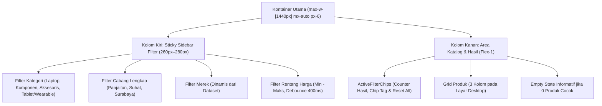

# PANDUAN IMPLEMENTASI TEKNIS — FASE 3: REAL-TIME CATALOG FILTERING & STICKY SIDEBAR
## Calosa Laptop & Gadget Store (Web Catalog & Comparison Experience)

Dokumen ini berisi panduan teknis langkah demi langkah (*step-by-step implementation guide*) beserta seluruh kode komponen dan instruksi eksekusi untuk **Fase 3** berdasarkan **PRD v2.0** (`FR-02`, `FR-03`, `FR-04`, `UX-01`, `UX-03`, `AC-02`, `AC-03`, `AC-04`, `AC-05`).

---

## 🎯 Tujuan & Cakupan Masalah Fase 3

Berdasarkan audit heuristik (Worksheet 1) dan pengujian pengguna (R1–R5), pengguna mengalami hambatan besar pada penyaringan katalog:
1. **Kategori Tercampur:** Di sistem lama, produk tablet dan smartwatch tercampur atau tidak konsisten. Di Fase 3, kategori dipisahkan secara ketat (`FR-02`, `AC-02`).
2. **Filter Tidak Terduga / Membingungkan:** Pengguna berekspektasi pembaruan langsung (*realtime*) saat mencentang opsi filter tanpa perlu mencari tombol "Apply" terpisah (`FR-03`, `AC-03`).
3. **Ketidakjelasan Cabang:** Cabang toko kini menampilkan nama lokasi lengkap dan jelas (`AC-03`).
4. **Transparansi Filter Aktif:** Menampilkan deretan *chip/tag* untuk setiap filter yang sedang aktif, dapat dihapus satu per satu, serta tombol "Reset Semua Filter" (`FR-04`, `AC-05`).
5. **Layout Desktop-First:** Mengimplementasikan **Sticky Sidebar** (`260px`–`280px`) di sisi kiri dan **Grid Produk (3 Kolom)** di sisi kanan (`UX-01`).

---

## 📐 Arsitektur Tata Letak Desktop-First (UX-01)



---

## 📁 Berkas yang Dibuat & Dimodifikasi

| Berkas | Peran | Tindakan |
| :--- | :--- | :--- |
| `resources/js/components/catalog/PriceRangeFilter.tsx` | Komponen input harga minimum & maksimum berlabel jelas dengan debounce & tombol terapkan | **Baru** |
| `resources/js/components/catalog/FilterSidebar.tsx` | Komponen bilah samping filter *sticky* dengan checkbox *realtime* (Kategori, Cabang, Merek, Harga) | **Baru** |
| `resources/js/components/catalog/ActiveFilterChips.tsx` | Komponen baris atas katalog untuk menampilkan jumlah produk, chip filter aktif, dan tombol reset | **Baru** |
| `resources/js/pages/CatalogPage.tsx` | Pengaturan layout 2 kolom (Sidebar kiri + Grid kanan) dan integrasi status filter | **Modifikasi** |

---

## 💻 Kode Lengkap & Penjelasan Komponen

### Langkah 1: Komponen Filter Rentang Harga (`PriceRangeFilter.tsx`)

Komponen ini memenuhi `FR-03` dan `AC-04`: memiliki label eksplisit "Harga Minimum" dan "Harga Maksimum", format angka Rupiah, *debounce* otomatis ($400\text{ms}$), serta tombol "Terapkan" di samping input.

📁 **Path:** `resources/js/components/catalog/PriceRangeFilter.tsx`

```tsx
import React, { useState, useEffect } from 'react';
import { useFilter } from '@/contexts/FilterContext';
import { Check } from 'lucide-react';

export default function PriceRangeFilter() {
  const { filters, setPriceRange } = useFilter();

  const [minInput, setMinInput] = useState<string>(
    filters.minPrice !== null ? filters.minPrice.toString() : ''
  );
  const [maxInput, setMaxInput] = useState<string>(
    filters.maxPrice !== null ? filters.maxPrice.toString() : ''
  );

  // Sinkronisasi dengan FilterContext jika filter direset dari luar
  useEffect(() => {
    setMinInput(filters.minPrice !== null ? filters.minPrice.toString() : '');
    setMaxInput(filters.maxPrice !== null ? filters.maxPrice.toString() : '');
  }, [filters.minPrice, filters.maxPrice]);

  // Debounce otomatis (400ms) saat pengguna mengetik harga (FR-03)
  useEffect(() => {
    const timer = setTimeout(() => {
      const minVal = minInput ? parseInt(minInput.replace(/\D/g, ''), 10) : null;
      const maxVal = maxInput ? parseInt(maxInput.replace(/\D/g, ''), 10) : null;

      // Hanya update jika nilai berbeda dari state saat ini
      if (minVal !== filters.minPrice || maxVal !== filters.maxPrice) {
        setPriceRange(
          isNaN(minVal as number) ? null : minVal,
          isNaN(maxVal as number) ? null : maxVal
        );
      }
    }, 400);

    return () => clearTimeout(timer);
  }, [minInput, maxInput]);

  // Terapkan harga secara manual / via tombol Enter
  const handleApply = (e?: React.FormEvent) => {
    if (e) e.preventDefault();
    const minVal = minInput ? parseInt(minInput.replace(/\D/g, ''), 10) : null;
    const maxVal = maxInput ? parseInt(maxInput.replace(/\D/g, ''), 10) : null;

    setPriceRange(
      isNaN(minVal as number) ? null : minVal,
      isNaN(maxVal as number) ? null : maxVal
    );
  };

  // Format angka ribuan untuk kenyamanan visual
  const formatNumber = (val: string) => {
    const raw = val.replace(/\D/g, '');
    if (!raw) return '';
    return new Intl.NumberFormat('id-ID').format(parseInt(raw, 10));
  };

  return (
    <form onSubmit={handleApply} className="space-y-3">
      {/* Input Harga Minimum (AC-04) */}
      <div>
        <label
          htmlFor="min-price"
          className="block text-xs font-semibold text-slate-600 mb-1"
        >
          Harga Minimum
        </label>
        <div className="relative">
          <span className="absolute left-3 top-1/2 -translate-y-1/2 text-xs font-bold text-slate-400">
            Rp
          </span>
          <input
            id="min-price"
            type="text"
            inputMode="numeric"
            placeholder="0"
            value={formatNumber(minInput)}
            onChange={(e) => setMinInput(e.target.value.replace(/\D/g, ''))}
            className="w-full pl-9 pr-3 py-1.5 text-xs bg-slate-50 border border-slate-200 rounded-lg text-slate-800 focus:bg-white focus:border-brand-500 focus:ring-2 focus:ring-brand-500/10 transition-all outline-none"
          />
        </div>
      </div>

      {/* Input Harga Maksimum (AC-04) */}
      <div>
        <label
          htmlFor="max-price"
          className="block text-xs font-semibold text-slate-600 mb-1"
        >
          Harga Maksimum
        </label>
        <div className="relative">
          <span className="absolute left-3 top-1/2 -translate-y-1/2 text-xs font-bold text-slate-400">
            Rp
          </span>
          <input
            id="max-price"
            type="text"
            inputMode="numeric"
            placeholder="Tanpa batas"
            value={formatNumber(maxInput)}
            onChange={(e) => setMaxInput(e.target.value.replace(/\D/g, ''))}
            className="w-full pl-9 pr-3 py-1.5 text-xs bg-slate-50 border border-slate-200 rounded-lg text-slate-800 focus:bg-white focus:border-brand-500 focus:ring-2 focus:ring-brand-500/10 transition-all outline-none"
          />
        </div>
      </div>

      {/* Tombol Terapkan Harga Cepat */}
      {(minInput || maxInput) && (
        <button
          type="submit"
          className="w-full py-1.5 bg-brand-50 hover:bg-brand-100 text-brand-600 border border-brand-200 rounded-lg text-xs font-semibold flex items-center justify-center gap-1.5 transition-colors"
        >
          <Check className="w-3.5 h-3.5" />
          <span>Terapkan Harga</span>
        </button>
      )}
    </form>
  );
}
```

---

### Langkah 2: Komponen Sticky Sidebar Filter (`FilterSidebar.tsx`)

Komponen ini merupakan sidebar kiri tetap (*sticky*, lebar `260px`–`280px` sesuai `UX-01`). Memuat filter Kategori eksak (`FR-02`), Cabang berlabel jelas (`FR-03`, `AC-03`), Merek dinamis, serta Rentang Harga. Checkbox bekerja secara *realtime* seketika saat diklik.

📁 **Path:** `resources/js/components/catalog/FilterSidebar.tsx`

```tsx
import React, { useMemo } from 'react';
import { useFilter } from '@/contexts/FilterContext';
import { CATEGORIES, BRANCHES, DUMMY_PRODUCTS } from '@/data/dummyProducts';
import { Category, BranchLocation } from '@/types/product';
import PriceRangeFilter from '@/components/catalog/PriceRangeFilter';
import { Filter, RotateCcw, ChevronDown, Laptop, Cpu, Mouse, Tablet } from 'lucide-react';

export default function FilterSidebar() {
  const {
    filters,
    toggleCategory,
    toggleBranch,
    toggleBrand,
    resetFilters,
    activeFilterCount,
    availableBrands,
  } = useFilter();

  // Hitung jumlah produk per kategori untuk mempermudah navigasi
  const categoryCount = useMemo(() => {
    const counts: Record<string, number> = {};
    CATEGORIES.forEach((cat) => {
      counts[cat] = DUMMY_PRODUCTS.filter((p) => p.category === cat).length;
    });
    return counts;
  }, []);

  // Ikon pendukung tiap kategori
  const getCategoryIcon = (category: Category) => {
    switch (category) {
      case 'Laptop':
        return <Laptop className="w-3.5 h-3.5 text-blue-500" />;
      case 'Komponen PC':
        return <Cpu className="w-3.5 h-3.5 text-purple-500" />;
      case 'Aksesoris':
        return <Mouse className="w-3.5 h-3.5 text-emerald-500" />;
      case 'Tablet & Wearable':
        return <Tablet className="w-3.5 h-3.5 text-amber-500" />;
    }
  };

  return (
    <aside className="w-[280px] flex-shrink-0">
      {/* Sticky Container Desktop (UX-01) */}
      <div className="sticky top-28 bg-white border border-slate-200 rounded-2xl p-5 shadow-sm space-y-6">
        {/* Header Sidebar */}
        <div className="flex items-center justify-between pb-4 border-b border-slate-100">
          <div className="flex items-center gap-2 text-slate-900 font-bold text-sm">
            <Filter className="w-4 h-4 text-brand-500" />
            <span>Filter Katalog</span>
          </div>

          {activeFilterCount > 0 && (
            <button
              onClick={resetFilters}
              className="text-xs font-semibold text-brand-500 hover:text-brand-600 flex items-center gap-1 transition-colors"
              title="Reset semua filter ke kondisi awal"
            >
              <RotateCcw className="w-3 h-3" />
              <span>Reset</span>
            </button>
          )}
        </div>

        {/* 1. Filter Kategori (FR-02, AC-02) */}
        <div>
          <h4 className="text-xs font-bold text-slate-900 uppercase tracking-wider mb-3 flex items-center justify-between">
            <span>Kategori Produk</span>
            <ChevronDown className="w-3.5 h-3.5 text-slate-400" />
          </h4>
          <div className="space-y-2">
            {CATEGORIES.map((cat) => {
              const isChecked = filters.selectedCategories.includes(cat);
              return (
                <label
                  key={cat}
                  className={`flex items-center justify-between p-2 rounded-xl text-xs font-medium cursor-pointer transition-colors ${
                    isChecked
                      ? 'bg-brand-50 text-brand-700 font-semibold'
                      : 'hover:bg-slate-50 text-slate-700'
                  }`}
                >
                  <div className="flex items-center gap-2.5">
                    <input
                      type="checkbox"
                      checked={isChecked}
                      onChange={() => toggleCategory(cat)}
                      className="w-4 h-4 text-brand-500 rounded border-slate-300 focus:ring-brand-500 focus:ring-offset-0 transition-colors"
                    />
                    <span className="flex items-center gap-1.5">
                      {getCategoryIcon(cat)}
                      {cat}
                    </span>
                  </div>
                  <span className="text-[11px] text-slate-400 font-normal">
                    ({categoryCount[cat] || 0})
                  </span>
                </label>
              );
            })}
          </div>
        </div>

        {/* 2. Filter Cabang Toko (FR-03, AC-03) */}
        <div className="pt-4 border-t border-slate-100">
          <h4 className="text-xs font-bold text-slate-900 uppercase tracking-wider mb-3 flex items-center justify-between">
            <span>Cabang Toko Calosa</span>
            <ChevronDown className="w-3.5 h-3.5 text-slate-400" />
          </h4>
          <div className="space-y-2.5">
            {BRANCHES.map((branch) => {
              const isChecked = filters.selectedBranches.includes(branch as BranchLocation);
              return (
                <label
                  key={branch}
                  className="flex items-start gap-2.5 text-xs text-slate-700 cursor-pointer hover:text-slate-900 group"
                >
                  <input
                    type="checkbox"
                    checked={isChecked}
                    onChange={() => toggleBranch(branch as BranchLocation)}
                    className="w-4 h-4 mt-0.5 text-brand-500 rounded border-slate-300 focus:ring-brand-500 focus:ring-offset-0 transition-colors"
                  />
                  <span className={`leading-relaxed ${isChecked ? 'font-semibold text-brand-700' : ''}`}>
                    {branch}
                  </span>
                </label>
              );
            })}
          </div>
        </div>

        {/* 3. Filter Rentang Harga (FR-03, AC-04) */}
        <div className="pt-4 border-t border-slate-100">
          <h4 className="text-xs font-bold text-slate-900 uppercase tracking-wider mb-3">
            Rentang Harga (Rp)
          </h4>
          <PriceRangeFilter />
        </div>

        {/* 4. Filter Merek (FR-03) */}
        <div className="pt-4 border-t border-slate-100">
          <h4 className="text-xs font-bold text-slate-900 uppercase tracking-wider mb-3 flex items-center justify-between">
            <span>Merek Produk</span>
            <ChevronDown className="w-3.5 h-3.5 text-slate-400" />
          </h4>
          <div className="max-h-48 overflow-y-auto space-y-2 pr-1 custom-scrollbar">
            {availableBrands.map((brand) => {
              const isChecked = filters.selectedBrands.includes(brand);
              return (
                <label
                  key={brand}
                  className="flex items-center gap-2.5 text-xs text-slate-700 cursor-pointer hover:text-slate-900"
                >
                  <input
                    type="checkbox"
                    checked={isChecked}
                    onChange={() => toggleBrand(brand)}
                    className="w-4 h-4 text-brand-500 rounded border-slate-300 focus:ring-brand-500 focus:ring-offset-0 transition-colors"
                  />
                  <span className={isChecked ? 'font-semibold text-brand-700' : ''}>
                    {brand}
                  </span>
                </label>
              );
            })}
          </div>
        </div>
      </div>
    </aside>
  );
}
```

---

### Langkah 3: Komponen Indikator Filter Aktif & Reset (`ActiveFilterChips.tsx`)

Komponen ini memenuhi `FR-04` dan `AC-05`: menampilkan total produk hasil filter, menampilkan *chip* untuk setiap filter yang aktif (bisa ditutup/dihapus satu per satu), serta tombol **"Reset Semua Filter"**.

📁 **Path:** `resources/js/components/catalog/ActiveFilterChips.tsx`

```tsx
import React from 'react';
import { useFilter } from '@/contexts/FilterContext';
import { X, RotateCcw } from 'lucide-react';

export default function ActiveFilterChips() {
  const {
    filters,
    totalResults,
    activeFilterCount,
    setSearchQuery,
    toggleCategory,
    toggleBranch,
    toggleBrand,
    setPriceRange,
    resetFilters,
  } = useFilter();

  const formatRupiah = (val: number) => {
    return new Intl.NumberFormat('id-ID', {
      style: 'currency',
      currency: 'IDR',
      maximumFractionDigits: 0,
    }).format(val);
  };

  return (
    <div className="bg-white rounded-2xl border border-slate-200 p-4 shadow-sm mb-6">
      <div className="flex flex-wrap items-center justify-between gap-3">
        {/* Counter Total Produk & Status */}
        <div className="flex items-center gap-2">
          <span className="text-sm font-bold text-slate-900">
            Katalog Produk
          </span>
          <span className="text-xs bg-slate-100 text-slate-600 px-2.5 py-1 rounded-full font-semibold">
            {totalResults} produk ditemukan
          </span>
        </div>

        {/* Tombol Reset Semua Filter (FR-04, AC-05) */}
        {activeFilterCount > 0 && (
          <button
            onClick={resetFilters}
            className="inline-flex items-center gap-1.5 text-xs font-semibold text-rose-600 hover:text-rose-700 hover:bg-rose-50 px-2.5 py-1.5 rounded-lg transition-colors"
          >
            <RotateCcw className="w-3.5 h-3.5" />
            <span>Reset Semua Filter</span>
          </button>
        )}
      </div>

      {/* Deretan Tag / Chip Filter Aktif (AC-05) */}
      {activeFilterCount > 0 && (
        <div className="flex flex-wrap items-center gap-2 mt-3 pt-3 border-t border-slate-100">
          <span className="text-xs text-slate-400 font-medium">
            Filter aktif:
          </span>

          {/* Chip Kata Kunci Pencarian */}
          {filters.searchQuery.trim() && (
            <span className="inline-flex items-center gap-1.5 px-3 py-1 rounded-full bg-brand-50 border border-brand-200 text-brand-700 text-xs font-medium">
              <span>Cari: &ldquo;{filters.searchQuery}&rdquo;</span>
              <button
                type="button"
                onClick={() => setSearchQuery('')}
                className="hover:bg-brand-200/60 rounded-full p-0.5 transition-colors"
                title="Hapus filter pencarian"
              >
                <X className="w-3 h-3" />
              </button>
            </span>
          )}

          {/* Chip Kategori */}
          {filters.selectedCategories.map((cat) => (
            <span
              key={cat}
              className="inline-flex items-center gap-1.5 px-3 py-1 rounded-full bg-blue-50 border border-blue-200 text-blue-700 text-xs font-medium"
            >
              <span>{cat}</span>
              <button
                type="button"
                onClick={() => toggleCategory(cat)}
                className="hover:bg-blue-200/60 rounded-full p-0.5 transition-colors"
                title={`Hapus kategori ${cat}`}
              >
                <X className="w-3 h-3" />
              </button>
            </span>
          ))}

          {/* Chip Cabang Toko */}
          {filters.selectedBranches.map((branch) => (
            <span
              key={branch}
              className="inline-flex items-center gap-1.5 px-3 py-1 rounded-full bg-emerald-50 border border-emerald-200 text-emerald-700 text-xs font-medium"
            >
              <span>{branch}</span>
              <button
                type="button"
                onClick={() => toggleBranch(branch)}
                className="hover:bg-emerald-200/60 rounded-full p-0.5 transition-colors"
                title={`Hapus cabang ${branch}`}
              >
                <X className="w-3 h-3" />
              </button>
            </span>
          ))}

          {/* Chip Merek */}
          {filters.selectedBrands.map((brand) => (
            <span
              key={brand}
              className="inline-flex items-center gap-1.5 px-3 py-1 rounded-full bg-purple-50 border border-purple-200 text-purple-700 text-xs font-medium"
            >
              <span>Merek: {brand}</span>
              <button
                type="button"
                onClick={() => toggleBrand(brand)}
                className="hover:bg-purple-200/60 rounded-full p-0.5 transition-colors"
                title={`Hapus merek ${brand}`}
              >
                <X className="w-3 h-3" />
              </button>
            </span>
          ))}

          {/* Chip Rentang Harga */}
          {(filters.minPrice !== null || filters.maxPrice !== null) && (
            <span className="inline-flex items-center gap-1.5 px-3 py-1 rounded-full bg-amber-50 border border-amber-200 text-amber-700 text-xs font-medium">
              <span>
                Harga:{' '}
                {filters.minPrice !== null ? formatRupiah(filters.minPrice) : 'Rp 0'}{' '}
                –{' '}
                {filters.maxPrice !== null
                  ? formatRupiah(filters.maxPrice)
                  : 'Tak Hingga'}
              </span>
              <button
                type="button"
                onClick={() => setPriceRange(null, null)}
                className="hover:bg-amber-200/60 rounded-full p-0.5 transition-colors"
                title="Hapus filter harga"
              >
                <X className="w-3 h-3" />
              </button>
            </span>
          )}
        </div>
      )}
    </div>
  );
}
```

---

### Langkah 4: Pembaruan Halaman Katalog Utama (`CatalogPage.tsx`)

Gabungkan tata letak Desktop-First: `FilterSidebar` di kolom kiri (`280px`) dan `ActiveFilterChips` beserta Grid Produk 3 kolom di kolom kanan (`UX-01`).

📁 **Path:** `resources/js/pages/CatalogPage.tsx`

```tsx
import React from 'react';
import { useFilter } from '@/contexts/FilterContext';
import { Head, Link } from '@inertiajs/react';
import FilterSidebar from '@/components/catalog/FilterSidebar';
import ActiveFilterChips from '@/components/catalog/ActiveFilterChips';
import { Search, ImageOff, RotateCcw, MapPin } from 'lucide-react';

export default function CatalogPage() {
  const { filteredProducts, resetFilters } = useFilter();

  const formatRupiah = (val: number) => {
    return new Intl.NumberFormat('id-ID', {
      style: 'currency',
      currency: 'IDR',
      maximumFractionDigits: 0,
    }).format(val);
  };

  return (
    <>
      <Head title="Katalog Produk & Filter Realtime — Calosa Store" />

      {/* Kontainer Desktop-First (UX-01: 2 Kolom) */}
      <div className="flex gap-8 items-start">
        {/* Kolom Kiri: Sticky Sidebar Filter (260px - 280px) */}
        <FilterSidebar />

        {/* Kolom Kanan: Header Filter Aktif & Grid Produk */}
        <section className="flex-1 min-w-0">
          {/* Indikator Filter Aktif, Counter & Tombol Reset (FR-04, AC-05) */}
          <ActiveFilterChips />

          {/* Grid Katalog Produk (Desktop 3 Kolom - UX-01) */}
          {filteredProducts.length > 0 ? (
            <div className="grid grid-cols-1 md:grid-cols-2 lg:grid-cols-3 gap-6">
              {filteredProducts.map((product) => (
                <div
                  key={product.id}
                  className="bg-white rounded-2xl border border-slate-200 overflow-hidden shadow-sm hover:shadow-md transition-shadow flex flex-col justify-between group"
                >
                  <div>
                    {/* Pratinjau Gambar atau Fallback (FR-07, AC-06) */}
                    <div className="h-48 w-full bg-slate-100 relative overflow-hidden flex items-center justify-center border-b border-slate-100">
                      {product.imageUrl ? (
                        
                      ) : (
                        <div className="flex flex-col items-center justify-center text-slate-400 gap-1.5">
                          <ImageOff className="w-8 h-8" />
                          <span className="text-xs font-medium">Gambar belum tersedia</span>
                        </div>
                      )}

                      {/* Badge Kategori */}
                      <span className="absolute top-3 left-3 bg-white/95 backdrop-blur-sm px-2.5 py-1 rounded-full text-xs font-semibold text-slate-700 shadow-sm border border-slate-100">
                        {product.category}
                      </span>
                    </div>

                    {/* Konten Kartu */}
                    <div className="p-5">
                      <div className="flex items-center justify-between text-xs text-slate-400 mb-1">
                        <span className="font-semibold uppercase tracking-wider">
                          {product.brand}
                        </span>
                        <span className="flex items-center gap-1 text-[11px] text-emerald-600 font-medium">
                          <MapPin className="w-3 h-3" />
                          {product.branches.length} Cabang
                        </span>
                      </div>

                      <h3 className="text-sm font-bold text-slate-800 line-clamp-2 mt-1 leading-snug group-hover:text-brand-600 transition-colors">
                        {product.name}
                      </h3>

                      {/* Ringkasan Spesifikasi (Highlight Specs) */}
                      <div className="mt-3 flex flex-wrap gap-1.5">
                        {product.highlightSpecs.map((spec, i) => (
                          <span
                            key={i}
                            className="text-[11px] bg-slate-100 text-slate-600 px-2 py-0.5 rounded-md font-medium"
                          >
                            {spec}
                          </span>
                        ))}
                      </div>
                    </div>
                  </div>

                  {/* Footer Kartu Produk */}
                  <div className="p-5 pt-0 border-t border-slate-100 mt-4 flex items-center justify-between">
                    <div>
                      <span className="text-xs text-slate-400 block">Harga</span>
                      <span className="text-base font-bold text-brand-600">
                        {formatRupiah(product.price)}
                      </span>
                    </div>

                    <Link
                      href={`/product/${product.id}`}
                      className="px-4 py-2 bg-slate-900 hover:bg-brand-600 text-white text-xs font-semibold rounded-xl transition-colors shadow-sm"
                    >
                      Lihat Detail
                    </Link>
                  </div>
                </div>
              ))}
            </div>
          ) : (
            /* Empty State Filter (UX-03) */
            <div className="bg-white rounded-2xl border border-dashed border-slate-300 p-12 text-center">
              <div className="w-16 h-16 mx-auto rounded-full bg-slate-100 flex items-center justify-center text-slate-400 mb-4">
                <Search className="w-8 h-8" />
              </div>
              <h3 className="text-lg font-bold text-slate-800">
                Tidak Ada Produk yang Cocok
              </h3>
              <p className="text-sm text-slate-500 max-w-md mx-auto mt-1 mb-6">
                Tidak ada produk di Calosa Store yang memenuhi kombinasi filter aktif saat ini. Coba longgarkan kriteria atau reset filter.
              </p>
              <button
                onClick={resetFilters}
                className="inline-flex items-center gap-2 px-5 py-2.5 rounded-xl bg-brand-500 hover:bg-brand-600 text-white text-xs font-semibold transition-colors shadow-md shadow-brand-500/20"
              >
                <RotateCcw className="w-4 h-4" />
                <span>Reset Semua Filter</span>
              </button>
            </div>
          )}
        </section>
      </div>
    </>
  );
}
```

---

## 🧪 Matriks Verifikasi Kriteria Penerimaan (AC-02 s/d AC-05)

Lakukan pengujian berikut di peramban (`http://127.0.0.1:8000`) untuk memvalidasi keberhasilan Fase 3:

| ID | Kriteria Penerimaan | Aksi Pengujian | Hasil yang Diharapkan | Status |
| :---: | :--- | :--- | :--- | :---: |
| **AC-02** | **Kategori Eksak** | Centang kategori `Tablet & Wearable`. | Hanya produk tablet/smartwatch yang muncul. Produk laptop atau komponen PC **tidak tercampur**. | [ ] |
| **AC-03** | **Realtime Checkbox Cabang & Kategori** | Centang salah satu cabang (misal: `Calosa Surabaya (Hi-Tech Mall)`). | Daftar produk **langsung terfilter seketika (*realtime*)** tanpa harus menekan tombol terpisah. | [ ] |
| **AC-03** | **Kelengkapan Label Cabang** | Periksa teks label cabang di sidebar. | Nama cabang tertulis lengkap dengan alamatnya (Panjaitan, Soekarno Hatta, Hi-Tech Mall). | [ ] |
| **AC-04** | **Input Rentang Harga Minimum & Maksimum** | Masukkan `Harga Minimum: 5.000.000` dan `Harga Maksimum: 15.000.000`. | Input memiliki label jelas, terformat Rupiah otomatis, dan setelah debounce $400\text{ms}$ hanya produk di dalam rentang tersebut yang tampil. | [ ] |
| **AC-05** | **Chip Filter Aktif Terlihat** | Pilih beberapa filter (kategori + brand + cabang). | Di atas katalog muncul *chip/tag* untuk setiap filter yang aktif. | [ ] |
| **AC-05** | **Hapus Filter Satuan** | Klik ikon silang (`X`) pada salah satu chip. | Hanya filter pada chip tersebut yang dihapus, filter lainnya tetap aktif. | [ ] |
| **AC-05** | **Reset Semua Filter** | Klik tombol **"Reset Semua Filter"**. | Seluruh filter aktif terhapus, dan seluruh produk katalog kembali tampil utuh. | [ ] |
| **UX-01** | **Sticky Sidebar Desktop** | Gulir (*scroll*) halaman ke bawah pada resolusi desktop. | Bilah sidebar filter tetap menempel rapi (*sticky*) di sisi kiri layar. | [ ] |
| **UX-03** | **Visual Feedback & Empty State** | Masukkan rentang harga yang mustahil (misal: Min 100 Juta). | Muncul tampilan *empty state* informatif dengan tombol reset filter. | [ ] |
