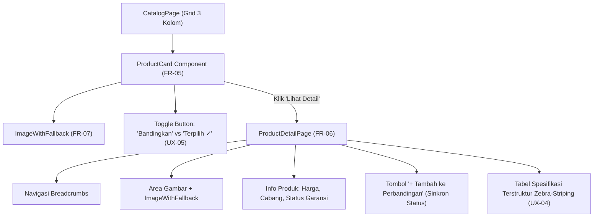

# PANDUAN IMPLEMENTASI TEKNIS — FASE 4: PRODUCT CARDS, DETAIL PAGE, & GRACEFUL FALLBACK
## Calosa Laptop & Gadget Store (Web Catalog & Comparison Experience)

Dokumen ini berisi panduan teknis langkah demi langkah (*step-by-step implementation guide*) beserta seluruh kode komponen dan instruksi eksekusi untuk **Fase 4** berdasarkan **PRD v2.0** (`FR-05`, `FR-06`, `FR-07`, `UX-04`, `UX-05`, `AC-06`, `AC-07`).

---

## 🎯 Tujuan & Cakupan Masalah Fase 4

Pada fase sebelumnya, pengguna dapat mencari dan memfilter katalog secara *realtime*. Namun, riset evaluasi menunjukkan kendala informasi produk:
1. **Defisit Kelengkapan & Kerusakan Visual:** Sejumlah produk tidak memiliki gambar, garansi, atau deskripsi. Sistem tidak boleh menampilkan gambar rusak (*broken image*) atau elemen tersembunyi tanpa kejelasan. Harus disediakan **penanganan elegan (*graceful fallback*)** berupa keterangan eksplisit (`FR-07`, `AC-06`).
2. **Kartu Produk Mudah Dipindai (*Scannable Card*):** Kartu katalog harus seragam tingginya (nama dibatasi 2 baris dengan *ellipsis*), memuat 2–3 poin spesifikasi kunci, status cabang, harga berformat Rupiah kontras tinggi, tombol "Lihat Detail", dan tombol "+ Bandingkan" (`FR-05`).
3. **Kejelasan Status Tombol Compare (*Visual Feedback*):** Tombol perbandingan pada kartu katalog dan halaman detail harus memiliki dua status visual yang sangat kontras: **"Bandingkan"** (default) dan **"Terpilih ✓"** (aktif) (`UX-05`, `AC-07`).
4. **Halaman Detail Produk Terstruktur:** Menyajikan foto, rincian ketersediaan di masing-masing cabang, status garansi resmi, deskripsi, serta **tabel spesifikasi teknis lengkap bergaris selang-seling (*zebra striping*)** agar mata pembeli teknis seperti **Jack** mudah membaca data (`FR-06`, `UX-04`).

---

## 📐 Arsitektur Alur & Struktur Komponen



---

## 📁 Berkas yang Dibuat & Dimodifikasi

| Berkas | Peran | Tindakan |
| :--- | :--- | :--- |
| `resources/js/components/catalog/ImageWithFallback.tsx` | Komponen penampil gambar dengan penanganan *broken image* / *null image* | **Baru** |
| `resources/js/components/catalog/ProductCard.tsx` | Komponen kartu katalog seragam, mudah dipindai (*scannable*), & tombol compare | **Baru** |
| `resources/js/components/catalog/SpecTable.tsx` | Komponen tabel spesifikasi terstruktur *key-value* dengan baris *zebra-striping* | **Baru** |
| `resources/js/pages/ProductDetailPage.tsx` | Halaman detail produk lengkap (ketersediaan cabang, garansi, deskripsi, specs) | **Baru** |
| `resources/js/pages/CatalogPage.tsx` | Mengganti elemen kartu inline dengan komponen `ProductCard` modular | **Modifikasi** |
| `routes/web.php` | Menghubungkan rute `/product/{id}` ke halaman `ProductDetailPage` | **Modifikasi** |

---

## 💻 Kode Lengkap & Penjelasan Komponen

### Langkah 1: Komponen Gambar dengan Graceful Fallback (`ImageWithFallback.tsx`)

Komponen ini memastikan jika `imageUrl === null` atau link gambar mengalami kegagalan muat (*broken error*), sistem langsung menampilkan ilustrasi visual dan teks informatif *"Gambar belum tersedia"* (`FR-07`, `AC-06`).

📁 **Path:** `resources/js/components/catalog/ImageWithFallback.tsx`

```tsx
import React, { useState } from 'react';
import { ImageOff } from 'lucide-react';

interface ImageWithFallbackProps {
  src: string | null;
  alt: string;
  className?: string;
  aspectRatioClass?: string;
}

export default function ImageWithFallback({
  src,
  alt,
  className = 'w-full h-full object-cover',
  aspectRatioClass = 'h-48 w-full',
}: ImageWithFallbackProps) {
  const [hasError, setHasError] = useState(false);

  // Jika src null atau terjadi error saat load gambar (FR-07)
  if (!src || hasError) {
    return (
      <div
        className={`${aspectRatioClass} bg-slate-100 flex flex-col items-center justify-center text-slate-400 gap-2 border-b border-slate-100 select-none`}
        role="img"
        aria-label="Gambar belum tersedia"
      >
        <div className="w-10 h-10 rounded-full bg-slate-200/70 flex items-center justify-center text-slate-400">
          <ImageOff className="w-5 h-5" />
        </div>
        <span className="text-[11px] font-medium text-slate-500">
          Gambar belum tersedia
        </span>
      </div>
    );
  }

  return (
     setHasError(true)}
      className={className}
      loading="lazy"
    />
  );
}
```

---

### Langkah 2: Komponen Kartu Produk Scannable (`ProductCard.tsx`)

Komponen ini memenuhi `FR-05`, `UX-04`, `UX-05`, `AC-06`, dan `AC-07`:
* Nama produk dibatasi 2 baris (`line-clamp-2`) dengan tinggi seragam.
* Menampilkan lencana kategori dan jumlah cabang yang memiliki stok.
* Menampilkan 2–3 poin ringkas spesifikasi utama (`highlightSpecs`).
* Harga dalam mata uang Rupiah kontras tinggi (`Rp X.XXX.XXX`).
* Tombol aksi ganda: **"Lihat Detail"** dan toggle perbandingan yang berganti visual secara kontras antara **"Bandingkan"** dan **"Terpilih ✓"** (`UX-05`).

📁 **Path:** `resources/js/components/catalog/ProductCard.tsx`

```tsx
import React from 'react';
import { Link } from '@inertiajs/react';
import { Product } from '@/types/product';
import { useCompare } from '@/Contexts/CompareContext';
import ImageWithFallback from '@/components/catalog/ImageWithFallback';
import { MapPin, Plus, Check } from 'lucide-react';

interface ProductCardProps {
  product: Product;
}

export default function ProductCard({ product }: ProductCardProps) {
  const { isInCompare, addToCompare, removeFromCompare } = useCompare();
  const selected = isInCompare(product.id);

  // Format harga Rupiah kontras tinggi (UX-04)
  const formatRupiah = (val: number) => {
    return new Intl.NumberFormat('id-ID', {
      style: 'currency',
      currency: 'IDR',
      maximumFractionDigits: 0,
    }).format(val);
  };

  // Toggle status perbandingan (AC-07)
  const handleToggleCompare = (e: React.MouseEvent) => {
    e.preventDefault();
    if (selected) {
      removeFromCompare(product.id);
    } else {
      addToCompare(product);
    }
  };

  return (
    <div className="bg-white rounded-2xl border border-slate-200 overflow-hidden shadow-sm hover:shadow-md transition-all duration-300 flex flex-col justify-between group">
      <div>
        {/* Gambar Produk dengan Fallback (FR-07) */}
        <div className="relative overflow-hidden bg-slate-100">
          <Link href={`/product/${product.id}`} className="block">
            <ImageWithFallback
              src={product.imageUrl}
              alt={product.name}
              aspectRatioClass="h-48 w-full"
              className="w-full h-48 object-cover group-hover:scale-105 transition-transform duration-300"
            />
          </Link>

          {/* Lencana Kategori */}
          <span className="absolute top-3 left-3 bg-white/95 backdrop-blur-sm px-2.5 py-1 rounded-full text-[11px] font-semibold text-slate-700 shadow-sm border border-slate-100">
            {product.category}
          </span>
        </div>

        {/* Konten Utama Kartu */}
        <div className="p-5">
          {/* Merek & Status Cabang */}
          <div className="flex items-center justify-between text-xs text-slate-400 mb-1.5">
            <span className="font-bold uppercase tracking-wider text-slate-500">
              {product.brand}
            </span>
            <span className="flex items-center gap-1 text-[11px] text-emerald-600 font-medium bg-emerald-50 px-2 py-0.5 rounded-full">
              <MapPin className="w-3 h-3" />
              {product.branches.length} Cabang
            </span>
          </div>

          {/* Nama Produk (Maks 2 Baris / Ellipsis - FR-05) */}
          <Link href={`/product/${product.id}`}>
            <h3
              className="text-sm font-bold text-slate-800 line-clamp-2 min-h-[2.5rem] leading-snug group-hover:text-brand-600 transition-colors"
              title={product.name}
            >
              {product.name}
            </h3>
          </Link>

          {/* Ringkasan Spesifikasi Kunci (Highlight Specs - FR-05) */}
          <div className="mt-3 flex flex-wrap gap-1.5 min-h-[3.25rem] content-start">
            {product.highlightSpecs.map((spec, i) => (
              <span
                key={i}
                className="text-[11px] bg-slate-100 text-slate-600 px-2.5 py-0.5 rounded-md font-medium"
              >
                {spec}
              </span>
            ))}
          </div>
        </div>
      </div>

      {/* Footer Kartu: Harga & Tombol Aksi */}
      <div className="p-5 pt-0 border-t border-slate-100 mt-2">
        {/* Harga */}
        <div className="pt-3 pb-3 flex items-baseline justify-between">
          <div>
            <span className="text-[10px] text-slate-400 font-medium block">
              Harga Mulai
            </span>
            <span className="text-base font-extrabold text-brand-600 tracking-tight">
              {formatRupiah(product.price)}
            </span>
          </div>
        </div>

        {/* Tombol Aksi Ganda (FR-05, UX-05, AC-07) */}
        <div className="grid grid-cols-2 gap-2">
          {/* Tombol Toggle Compare dengan Status Kontras (UX-05) */}
          <button
            type="button"
            onClick={handleToggleCompare}
            className={`py-2 px-2.5 rounded-xl text-xs font-semibold flex items-center justify-center gap-1.5 transition-all ${
              selected
                ? 'bg-emerald-500 hover:bg-emerald-600 text-white shadow-sm shadow-emerald-500/20'
                : 'bg-slate-100 hover:bg-slate-200 text-slate-700'
            }`}
            title={selected ? 'Hapus dari perbandingan' : 'Tambah ke perbandingan'}
          >
            {selected ? (
              <>
                <Check className="w-3.5 h-3.5 stroke-[3]" />
                <span>Terpilih ✓</span>
              </>
            ) : (
              <>
                <Plus className="w-3.5 h-3.5" />
                <span>Bandingkan</span>
              </>
            )}
          </button>

          {/* Tombol Lihat Detail */}
          <Link
            href={`/product/${product.id}`}
            className="py-2 px-2.5 rounded-xl text-xs font-semibold text-center bg-slate-900 hover:bg-brand-600 text-white transition-colors shadow-sm"
          >
            Lihat Detail
          </Link>
        </div>
      </div>
    </div>
  );
}
```

---

### Langkah 3: Komponen Tabel Spesifikasi Zebra-Striping (`SpecTable.tsx`)

Komponen ini memenuhi `FR-06` dan `UX-04`: menyajikan spesifikasi teknis dalam bentuk tabel pasangan *key-value* dengan latar baris selang-seling (*zebra striping*) agar mempermudah pembacaan bagi pembeli teknis seperti **Jack**.

📁 **Path:** `resources/js/components/catalog/SpecTable.tsx`

```tsx
import React from 'react';

interface SpecTableProps {
  specs: Record<string, string>;
}

export default function SpecTable({ specs }: SpecTableProps) {
  const specEntries = Object.entries(specs);

  if (specEntries.length === 0) {
    return (
      <p className="text-xs text-slate-400 italic py-4">
        Spesifikasi teknis belum dicantumkan.
      </p>
    );
  }

  return (
    <div className="overflow-hidden rounded-xl border border-slate-200">
      <table className="w-full text-left border-collapse text-xs">
        <tbody>
          {specEntries.map(([key, value], idx) => (
            <tr
              key={key}
              className={`border-b border-slate-100 last:border-b-0 transition-colors ${
                idx % 2 === 0 ? 'bg-white' : 'bg-slate-50/80' // Zebra Striping (UX-04)
              }`}
            >
              <td className="w-1/3 py-3 px-4 font-semibold text-slate-600 align-top">
                {key}
              </td>
              <td className="w-2/3 py-3 px-4 text-slate-800 font-medium leading-relaxed align-top">
                {value}
              </td>
            </tr>
          ))}
        </tbody>
      </table>
    </div>
  );
}
```

---

### Langkah 4: Halaman Detail Produk Lengkap (`ProductDetailPage.tsx`)

Halaman ini mengimplementasikan `FR-06`, `FR-07`, `UX-04`, `UX-05`, `AC-06`, dan `AC-07`. Memuat navigasi *breadcrumbs*, galeri foto/fallback, ketersediaan cabang, status garansi, deskripsi, tabel spesifikasi, dan tombol sinkron "+ Tambah ke Perbandingan".

📁 **Path:** `resources/js/pages/ProductDetailPage.tsx`

```tsx
import React from 'react';
import { Head, Link } from '@inertiajs/react';
import AppLayout from '@/Layouts/AppLayout';
import { DUMMY_PRODUCTS } from '@/data/dummyProducts';
import { useCompare } from '@/Contexts/CompareContext';
import ImageWithFallback from '@/components/catalog/ImageWithFallback';
import SpecTable from '@/components/catalog/SpecTable';
import {
  ChevronRight,
  ShieldCheck,
  ShieldAlert,
  MapPin,
  Check,
  Plus,
  ArrowLeft,
  FileText,
  Layers,
} from 'lucide-react';

interface ProductDetailPageProps {
  productId: string;
}

export default function ProductDetailPage({ productId }: ProductDetailPageProps) {
  // Cari produk dari dummy data
  const product = DUMMY_PRODUCTS.find((p) => p.id === productId);

  const { isInCompare, addToCompare, removeFromCompare } = useCompare();
  const selected = product ? isInCompare(product.id) : false;

  const formatRupiah = (val: number) => {
    return new Intl.NumberFormat('id-ID', {
      style: 'currency',
      currency: 'IDR',
      maximumFractionDigits: 0,
    }).format(val);
  };

  // Jika produk tidak ditemukan
  if (!product) {
    return (
      <AppLayout>
        <Head title="Produk Tidak Ditemukan — Calosa Store" />
        <div className="bg-white rounded-2xl border border-slate-200 p-12 text-center max-w-lg mx-auto">
          <h2 className="text-xl font-bold text-slate-900 mb-2">
            Produk Tidak Ditemukan
          </h2>
          <p className="text-sm text-slate-500 mb-6">
            Produk dengan identitas yang Anda cari tidak tersedia di katalog Calosa.
          </p>
          <Link
            href="/"
            className="inline-flex items-center gap-2 px-5 py-2.5 rounded-xl bg-brand-500 hover:bg-brand-600 text-white text-xs font-semibold transition-colors"
          >
            <ArrowLeft className="w-4 h-4" />
            <span>Kembali ke Katalog</span>
          </Link>
        </div>
      </AppLayout>
    );
  }

  const handleToggleCompare = () => {
    if (selected) {
      removeFromCompare(product.id);
    } else {
      addToCompare(product);
    }
  };

  return (
    <AppLayout>
      <Head title={`${product.name} — Calosa Laptop & Gadget Store`} />

      <div className="space-y-8">
        {/* 1. Navigasi Breadcrumb */}
        <nav className="flex items-center gap-2 text-xs text-slate-500">
          <Link href="/" className="hover:text-brand-500 transition-colors">
            Katalog
          </Link>
          <ChevronRight className="w-3.5 h-3.5 text-slate-300" />
          <span className="text-slate-600 font-medium">{product.category}</span>
          <ChevronRight className="w-3.5 h-3.5 text-slate-300" />
          <span className="text-slate-900 font-semibold truncate max-w-md">
            {product.name}
          </span>
        </nav>

        {/* 2. Ringkasan Atas: Foto & Informasi Utama (2 Kolom Desktop) */}
        <div className="grid grid-cols-1 lg:grid-cols-12 gap-8 items-start">
          {/* Area Foto Produk dengan Fallback (FR-07, AC-06) */}
          <div className="lg:col-span-5 bg-white border border-slate-200 rounded-3xl p-6 shadow-sm">
            <div className="rounded-2xl overflow-hidden bg-slate-100 flex items-center justify-center">
              <ImageWithFallback
                src={product.imageUrl}
                alt={product.name}
                aspectRatioClass="h-80 w-full"
                className="w-full h-80 object-cover"
              />
            </div>
            {/* Lencana Kategori */}
            <div className="mt-4 flex items-center justify-between text-xs text-slate-500">
              <span className="px-3 py-1 rounded-full bg-slate-100 font-semibold text-slate-700">
                {product.category}
              </span>
              <span className="font-semibold text-slate-600 uppercase tracking-wider">
                Merek: {product.brand}
              </span>
            </div>
          </div>

          {/* Area Spesifikasi Cepat & Aksi */}
          <div className="lg:col-span-7 bg-white border border-slate-200 rounded-3xl p-8 shadow-sm space-y-6">
            <div>
              <span className="text-xs font-bold text-brand-600 uppercase tracking-wider">
                {product.brand}
              </span>
              <h1 className="text-2xl font-extrabold text-slate-900 mt-1 leading-snug">
                {product.name}
              </h1>
            </div>

            {/* Harga Kontras Tinggi (UX-04) */}
            <div className="p-4 rounded-2xl bg-slate-50 border border-slate-100 flex items-baseline justify-between">
              <div>
                <span className="text-xs text-slate-400 font-medium block">
                  Harga Resmi Toko
                </span>
                <span className="text-3xl font-extrabold text-brand-600 tracking-tight">
                  {formatRupiah(product.price)}
                </span>
              </div>

              {/* Tombol Perbandingan Sinkron (UX-05, AC-07) */}
              <button
                type="button"
                onClick={handleToggleCompare}
                className={`py-2.5 px-5 rounded-xl text-xs font-bold flex items-center gap-2 transition-all ${
                  selected
                    ? 'bg-emerald-500 hover:bg-emerald-600 text-white shadow-lg shadow-emerald-500/20'
                    : 'bg-brand-500 hover:bg-brand-600 text-white shadow-lg shadow-brand-500/20'
                }`}
              >
                {selected ? (
                  <>
                    <Check className="w-4 h-4 stroke-[3]" />
                    <span>Terpilih dalam Perbandingan ✓</span>
                  </>
                ) : (
                  <>
                    <Plus className="w-4 h-4 stroke-[2.5]" />
                    <span>+ Tambah ke Perbandingan</span>
                  </>
                )}
              </button>
            </div>

            {/* Informasi Garansi dengan Graceful Fallback (FR-07, AC-06) */}
            <div className="flex items-start gap-3 p-4 rounded-xl border border-slate-100 bg-slate-50/50">
              {product.warranty ? (
                <>
                  <ShieldCheck className="w-5 h-5 text-emerald-500 flex-shrink-0 mt-0.5" />
                  <div>
                    <span className="text-xs font-bold text-slate-800 block">
                      Garansi Resmi
                    </span>
                    <span className="text-xs text-slate-600">
                      {product.warranty}
                    </span>
                  </div>
                </>
              ) : (
                <>
                  <ShieldAlert className="w-5 h-5 text-amber-500 flex-shrink-0 mt-0.5" />
                  <div>
                    <span className="text-xs font-bold text-slate-800 block">
                      Status Garansi
                    </span>
                    {/* Fallback Eksplisit (FR-07, AC-06) */}
                    <span className="text-xs text-amber-700 italic">
                      Informasi garansi belum dicantumkan
                    </span>
                  </div>
                </>
              )}
            </div>

            {/* Ketersediaan Cabang Toko Calosa */}
            <div>
              <h3 className="text-xs font-bold text-slate-900 uppercase tracking-wider mb-2 flex items-center gap-1.5">
                <MapPin className="w-4 h-4 text-brand-500" />
                <span>Ketersediaan Stok Cabang</span>
              </h3>
              <div className="space-y-1.5">
                {product.branches.map((branch, i) => (
                  <div
                    key={i}
                    className="flex items-center justify-between py-1.5 px-3 rounded-lg bg-emerald-50/60 border border-emerald-100 text-xs"
                  >
                    <span className="font-medium text-slate-700">{branch}</span>
                    <span className="text-[11px] font-semibold text-emerald-700">
                      Tersedia ✓
                    </span>
                  </div>
                ))}
              </div>
            </div>

            {/* Deskripsi Produk dengan Fallback (FR-07, AC-06) */}
            <div>
              <h3 className="text-xs font-bold text-slate-900 uppercase tracking-wider mb-2 flex items-center gap-1.5">
                <FileText className="w-4 h-4 text-slate-400" />
                <span>Deskripsi Produk</span>
              </h3>
              {product.description ? (
                <p className="text-xs text-slate-600 leading-relaxed">
                  {product.description}
                </p>
              ) : (
                /* Fallback Deskripsi Kosong (FR-07) */
                <p className="text-xs text-slate-400 italic">
                  Deskripsi produk belum tersedia.
                </p>
              )}
            </div>
          </div>
        </div>

        {/* 3. Bagian Bawah: Tabel Spesifikasi Lengkap Terstruktur (UX-04) */}
        <div className="bg-white border border-slate-200 rounded-3xl p-8 shadow-sm space-y-4">
          <div className="flex items-center gap-2 pb-3 border-b border-slate-100">
            <Layers className="w-5 h-5 text-brand-500" />
            <h2 className="text-lg font-bold text-slate-900">
              Spesifikasi Teknis Lengkap
            </h2>
          </div>

          {/* Tabel Zebra Striping (UX-04) */}
          <SpecTable specs={product.fullSpecs} />
        </div>
      </div>
    </AppLayout>
  );
}
```

---

### Langkah 5: Pembaruan Halaman Katalog (`CatalogPage.tsx`)

Ganti elemen perulangan kartu produk inline di `CatalogPage.tsx` dengan komponen `ProductCard` modular yang baru dibuat.

📁 **Path:** `resources/js/pages/CatalogPage.tsx` (modifikasi pada bagian render grid produk):

```tsx
// Ganti blok perulangan filteredProducts.map sebelumnya dengan:
import ProductCard from '@/components/catalog/ProductCard';

// Di dalam blok JSX grid:
{filteredProducts.length > 0 ? (
  <div className="grid grid-cols-1 md:grid-cols-2 lg:grid-cols-3 gap-6">
    {filteredProducts.map((product) => (
      <ProductCard key={product.id} product={product} />
    ))}
  </div>
) : (
  /* Empty State */
  ...
)}
```

---

### Langkah 6: Pembaruan Rute Web Laravel (`routes/web.php`)

Pastikan rute `/product/{id}` memuat `ProductDetailPage` dan meneruskan parameter ID produk.

📁 **Path:** `routes/web.php`

```php
<?php

use Illuminate\Support\Facades\Route;
use Inertia\Inertia;

// Halaman Utama Katalog & Pencarian
Route::get('/', function () {
    return Inertia::render('CatalogPage');
})->name('catalog');

// Halaman Detail Produk Lengkap (Fase 4)
Route::get('/product/{id}', function ($id) {
    return Inertia::render('ProductDetailPage', [
        'productId' => $id,
    ]);
})->name('product.detail');

// Placeholder untuk Rute Compare (Fase 5)
Route::get('/compare', function () {
    return Inertia::render('CatalogPage');
})->name('compare');
```

---

## 🧪 Matriks Verifikasi Kriteria Penerimaan (AC-06 & AC-07)

Lakukan pengujian berikut di peramban (`http://127.0.0.1:8000`) untuk memvalidasi keberhasilan Fase 4:

| No | Kriteria Penerimaan | Aksi Pengujian | Hasil yang Diharapkan | Status |
| :---: | :--- | :--- | :--- | :---: |
| 1 | **Penanganan Missing Image (AC-06)** | Cari produk `Acer Swift Go 14` atau `Thermal Grizzly` pada katalog atau buka halaman detailnya. | Tampil ilustrasi placeholder visual dan tulisan *"Gambar belum tersedia"*, tanpa ikon gambar rusak (*broken image*). | [ ] |
| 2 | **Penanganan Missing Warranty (AC-06)** | Buka halaman detail produk `Thermal Grizzly Kryonaut Extreme`. | Tampil label status eksplisit *"Informasi garansi belum dicantumkan"*. | [ ] |
| 3 | **Penanganan Missing Description (AC-06)** | Buka halaman detail produk `Anker PowerPort III 65W Pod`. | Tampil keterangan eksplisit *"Deskripsi produk belum tersedia"*. | [ ] |
| 4 | **Keseragaman Kartu Katalog (FR-05)** | Periksa tinggi kartu katalog pada berbagai produk dengan panjang nama yang berbeda. | Nama terpotong rapi maksimal 2 baris (*ellipsis*) dan tinggi kartu tetap sejajar/konsisten. | [ ] |
| 5 | **Toggle Compare di Katalog (UX-05, AC-07)** | Klik tombol **"+ Bandingkan"** pada salah satu produk di kartu katalog. | Tombol langsung berubah status visual menjadi hijau bertuliskan **"Terpilih ✓"** dan angka counter badge di header bertambah. | [ ] |
| 6 | **Sinkronisasi Tombol Detail (AC-07)** | Tambahkan produk dari katalog, lalu klik **"Lihat Detail"** produk tersebut. | Di halaman detail, tombol perbandingan sudah berstatus **"Terpilih dalam Perbandingan ✓"**. Jika diklik kembali, statusnya berubah menjadi **"+ Tambah ke Perbandingan"**. | [ ] |
| 7 | **Tabel Spesifikasi Zebra Striping (UX-04)** | Periksa tabel spesifikasi lengkap pada halaman detail laptop atau komponen. | Baris spesifikasi berlatar selang-seling abu-abu/putih (*zebra striping*) dan mudah dipindai secara horizontal. | [ ] |
| 8 | **Daftar Stok Cabang (FR-06)** | Periksa bagian ketersediaan cabang pada halaman detail. | Seluruh cabang yang memiliki stok produk tersebut ditampilkan secara jelas. | [ ] |
