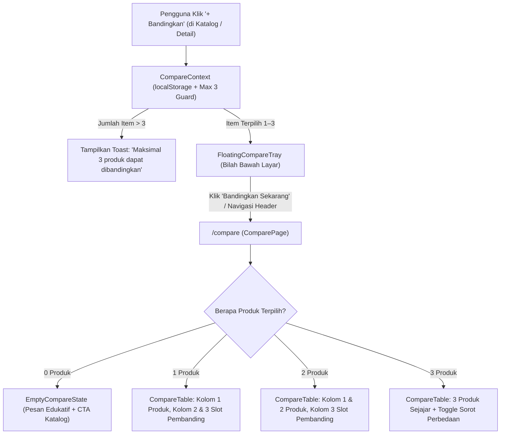

# PANDUAN IMPLEMENTASI TEKNIS — FASE 5: FITUR COMPARE PRODUCTS
## Calosa Laptop & Gadget Store (Web Catalog & Comparison Experience)

Dokumen ini berisi panduan teknis langkah demi langkah (*step-by-step implementation guide*) beserta seluruh kode komponen dan instruksi eksekusi untuk **Fase 5** berdasarkan **PRD v2.0** (`FR-08`, `FR-09`, `FR-10`, `UX-05`, `AC-07`, `AC-08`, `AC-09`, `AC-10`).

---

## 🎯 Tujuan & Cakupan Masalah Fase 5

Berdasarkan audit heuristik (Worksheet 1) dan masukan 5 responden (R1–R5), fitur perbandingan produk mengalami masalah kritis:
1. **Broken Empty State:** Halaman perbandingan sebelumnya menampilkan area kosong tanpa penjelasan maupun mekanisme pemilihan produk yang intuitif (`FR-10`, `AC-10`).
2. **Manajemen Batas Antrean (Maks. 3 Produk):** Pengguna dapat memilih 1 hingga maksimal 3 produk baik dari katalog maupun detail. Jika pengguna mencoba memilih produk ke-4, sistem memunculkan *toast notification* pencegahan yang informatif (`FR-08`, `AC-08`).
3. **Floating Compare Tray:** Bilah mengambang di bawah layar yang memperlihatkan daftar produk terpilih, slot kosong yang tersisa, dan tombol pintas *"Bandingkan Sekarang"* (`FR-08`).
4. **Tabel Perbandingan Berdampingan (*Side-by-Side*):** Menampilkan hingga 3 produk secara sejajar dengan baris atribut (harga, garansi, cabang, spesifikasi teknis) yang lurus rapi (`FR-09`, `AC-09`).
5. **Fitur "Soroti Perbedaan" (*Highlight Differences*):** Tombol sakelar untuk mewarnai baris spesifikasi yang nilainya berbeda antar produk pembanding (`FR-09`).
6. **Penanganan Produk Lintas Kategori:** Memberikan tanda `—` (*Tidak tersedia*) untuk spesifikasi yang tidak dimiliki salah satu produk (`FR-09`).
7. **Partial State Interaktif:** Jika baru 1 atau 2 produk dipilih, kolom berikutnya menampilkan kartu slot kosong bergaris putus-putus (*dashed border*) dengan tombol CTA *"+ Tambah Produk Pembanding"* (`FR-10`, `AC-10`).

---

## 📐 Arsitektur Alur & Struktur Komponen



---

## 📁 Berkas yang Dibuat & Dimodifikasi

| Berkas | Peran | Tindakan |
| :--- | :--- | :--- |
| `resources/js/components/compare/FloatingCompareTray.tsx` | Bilah mengambang bawah layar untuk memantau antrean perbandingan produk | **Baru** |
| `resources/js/components/compare/EmptyCompareState.tsx` | Tampilan informatif jika halaman compare dibuka saat 0 produk terpilih | **Baru** |
| `resources/js/components/compare/CompareTable.tsx` | Tabel perbandingan berdampingan 3 kolom dengan slot interaktif & toggle selisih | **Baru** |
| `resources/js/pages/ComparePage.tsx` | Halaman utama rute `/compare` | **Baru** |
| `resources/js/contexts/CompareContext.tsx` | Menambahkan persistensi data ke `localStorage` agar tidak hilang saat pindah halaman | **Modifikasi** |
| `resources/js/layouts/AppLayout.tsx` | Menyematkan `FloatingCompareTray` secara global di layout | **Modifikasi** |
| `routes/web.php` | Menghubungkan rute `/compare` ke `ComparePage` | **Modifikasi** |

---

## 💻 Kode Lengkap & Penjelasan Komponen

### Langkah 1: Peningkatan `CompareContext.tsx` dengan Persistensi `localStorage`

Agar produk yang dipilih pengguna tidak hilang saat berpindah halaman antara Katalog (`/`), Detail (`/product/{id}`), dan Perbandingan (`/compare`), simpan antrean produk ke dalam `localStorage`.

📁 **Path:** `resources/js/contexts/CompareContext.tsx`

```tsx
import React, { createContext, useContext, useState, useEffect, ReactNode } from 'react';
import { Product } from '@/types/product';

interface CompareContextType {
  compareList: Product[];
  addToCompare: (product: Product) => boolean;
  removeFromCompare: (productId: string) => void;
  clearCompare: () => void;
  isInCompare: (productId: string) => boolean;
  toastMessage: string | null;
  dismissToast: () => void;
}

const STORAGE_KEY = 'calosa_compare_items';

const CompareContext = createContext<CompareContextType | undefined>(undefined);

export const CompareProvider: React.FC<{ children: ReactNode }> = ({ children }) => {
  // Inisialisasi state dari localStorage jika ada
  const [compareList, setCompareList] = useState<Product[]>(() => {
    if (typeof window !== 'undefined') {
      try {
        const saved = localStorage.getItem(STORAGE_KEY);
        return saved ? JSON.parse(saved) : [];
      } catch (err) {
        console.error('Gagal membaca localStorage compare list:', err);
        return [];
      }
    }
    return [];
  });

  const [toastMessage, setToastMessage] = useState<string | null>(null);

  // Simpan setiap perubahan compareList ke localStorage
  useEffect(() => {
    try {
      localStorage.setItem(STORAGE_KEY, JSON.stringify(compareList));
    } catch (err) {
      console.error('Gagal menyimpan compare list ke localStorage:', err);
    }
  }, [compareList]);

  const addToCompare = (product: Product): boolean => {
    if (compareList.some((item) => item.id === product.id)) {
      return false;
    }
    // Batasan maksimal 3 produk sesuai FR-08 & AC-08
    if (compareList.length >= 3) {
      setToastMessage('Maksimal 3 produk dapat dibandingkan sekaligus.');
      return false;
    }
    setCompareList((prev) => [...prev, product]);
    return true;
  };

  const removeFromCompare = (productId: string) => {
    setCompareList((prev) => prev.filter((item) => item.id !== productId));
  };

  const clearCompare = () => {
    setCompareList([]);
  };

  const isInCompare = (productId: string): boolean => {
    return compareList.some((item) => item.id === productId);
  };

  const dismissToast = () => {
    setToastMessage(null);
  };

  return (
    <CompareContext.Provider
      value={{
        compareList,
        addToCompare,
        removeFromCompare,
        clearCompare,
        isInCompare,
        toastMessage,
        dismissToast,
      }}
    >
      {children}
    </CompareContext.Provider>
  );
};

export const useCompare = () => {
  const context = useContext(CompareContext);
  if (!context) {
    throw new Error('useCompare harus digunakan di dalam CompareProvider');
  }
  return context;
};
```

---

### Langkah 2: Komponen Floating Compare Tray (`FloatingCompareTray.tsx`)

Bilah mengambang di bawah layar (`fixed bottom-6`) yang otomatis muncul jika ada $\ge 1$ produk yang dipilih. Menampilkan thumbnail produk, nama ringkas, tombol hapus item, slot sisa yang kosong, tombol *"Kosongkan"*, dan tombol CTA utama *"Bandingkan Sekarang"* (`FR-08`).

📁 **Path:** `resources/js/components/compare/FloatingCompareTray.tsx`

```tsx
import React from 'react';
import { Link } from '@inertiajs/react';
import { useCompare } from '@/contexts/CompareContext';
import ImageWithFallback from '@/components/catalog/ImageWithFallback';
import { Scale, X, ArrowRight, Trash2 } from 'lucide-react';

export default function FloatingCompareTray() {
  const { compareList, removeFromCompare, clearCompare } = useCompare();

  // Jika tidak ada produk yang dipilih, jangan tampilkan tray
  if (compareList.length === 0) {
    return null;
  }

  // Hitung berapa slot kosong dari maksimal 3 produk
  const emptySlotsCount = Math.max(0, 3 - compareList.length);

  return (
    <div className="fixed bottom-6 left-1/2 -translate-x-1/2 z-40 w-full max-w-4xl px-4 animate-slideUp">
      <div className="bg-slate-900/95 backdrop-blur-md text-white border border-slate-700/60 rounded-2xl p-4 shadow-2xl flex flex-wrap items-center justify-between gap-4">
        {/* Info & Counter */}
        <div className="flex items-center gap-3">
          <div className="w-10 h-10 rounded-xl bg-brand-500 flex items-center justify-center text-white shadow-md shadow-brand-500/30 flex-shrink-0">
            <Scale className="w-5 h-5" />
          </div>
          <div>
            <div className="flex items-center gap-2">
              <span className="text-sm font-bold tracking-tight">
                Perbandingan Produk
              </span>
              <span className="px-2 py-0.5 rounded-full bg-brand-500/30 text-brand-300 border border-brand-500/40 text-[11px] font-bold">
                {compareList.length}/3 Terpilih
              </span>
            </div>
            <p className="text-xs text-slate-400">
              Pilih hingga 3 produk untuk dibandingkan berdampingan
            </p>
          </div>
        </div>

        {/* Daftar Thumbnail Produk & Slot Kosong */}
        <div className="flex items-center gap-3">
          {/* Produk yang sudah dipilih */}
          {compareList.map((product) => (
            <div
              key={product.id}
              className="relative group bg-slate-800 rounded-xl border border-slate-700 p-1.5 flex items-center gap-2.5 max-w-[170px]"
            >
              <div className="w-9 h-9 rounded-lg bg-slate-900 overflow-hidden flex-shrink-0 flex items-center justify-center">
                <ImageWithFallback
                  src={product.imageUrl}
                  alt={product.name}
                  aspectRatioClass="w-9 h-9"
                  className="w-full h-full object-cover"
                />
              </div>
              <span className="text-xs font-semibold text-slate-200 truncate pr-4">
                {product.name}
              </span>

              {/* Tombol Hapus per Item */}
              <button
                type="button"
                onClick={() => removeFromCompare(product.id)}
                className="absolute -top-1.5 -right-1.5 w-5 h-5 rounded-full bg-rose-500 hover:bg-rose-600 text-white flex items-center justify-center text-[10px] shadow-sm transition-transform hover:scale-110"
                title={`Hapus ${product.name}`}
              >
                <X className="w-3 h-3" />
              </button>
            </div>
          ))}

          {/* Slot Kosong Tersisa */}
          {Array.from({ length: emptySlotsCount }).map((_, idx) => (
            <div
              key={`empty-${idx}`}
              className="hidden sm:flex items-center justify-center px-3 py-2 rounded-xl border border-dashed border-slate-700 text-slate-500 text-xs font-medium"
            >
              + Slot Kosong
            </div>
          ))}
        </div>

        {/* Tombol Aksi */}
        <div className="flex items-center gap-2">
          {/* Tombol Kosongkan Semua */}
          <button
            type="button"
            onClick={clearCompare}
            className="p-2 text-slate-400 hover:text-rose-400 hover:bg-slate-800 rounded-xl transition-colors text-xs flex items-center gap-1 font-medium"
            title="Kosongkan daftar perbandingan"
          >
            <Trash2 className="w-4 h-4" />
            <span className="hidden md:inline">Kosongkan</span>
          </button>

          {/* Tombol CTA Bandingkan Sekarang */}
          <Link
            href="/compare"
            className="py-2.5 px-4 bg-brand-500 hover:bg-brand-600 text-white rounded-xl text-xs font-bold flex items-center gap-2 shadow-lg shadow-brand-500/25 transition-all hover:gap-3"
          >
            <span>Bandingkan Sekarang</span>
            <ArrowRight className="w-4 h-4" />
          </Link>
        </div>
      </div>
    </div>
  );
}
```

---

### Langkah 3: Komponen Kondisi Kosong Informatif (`EmptyCompareState.tsx`)

Komponen ini memecahkan masalah *broken empty state* (`FR-10`, `AC-10`). Menampilkan pesan bersahabat jika pengguna membuka `/compare` tanpa ada produk yang dipilih, disertai tombol CTA *"Pilih Produk di Katalog"*.

📁 **Path:** `resources/js/components/compare/EmptyCompareState.tsx`

```tsx
import React from 'react';
import { Link } from '@inertiajs/react';
import { Scale, ArrowLeft, PlusCircle } from 'lucide-react';

export default function EmptyCompareState() {
  return (
    <div className="bg-white border border-slate-200 rounded-3xl p-12 text-center max-w-2xl mx-auto shadow-sm my-8">
      {/* Ikon Ilustrasi */}
      <div className="w-20 h-20 mx-auto rounded-3xl bg-brand-50 text-brand-500 border border-brand-100 flex items-center justify-center mb-6 shadow-inner">
        <Scale className="w-10 h-10" />
      </div>

      {/* Teks Penjelasan Ramah (FR-10, AC-10) */}
      <h2 className="text-xl font-extrabold text-slate-900 tracking-tight">
        Belum Ada Produk yang Dipilih untuk Dibandingkan
      </h2>
      <p className="text-sm text-slate-500 mt-2 max-w-md mx-auto leading-relaxed">
        Anda dapat memilih 1 hingga maksimal 3 produk dari katalog toko maupun dari halaman detail produk dengan menekan tombol <strong>&ldquo;+ Bandingkan&rdquo;</strong>.
      </p>

      {/* Langkah Panduan Singkat */}
      <div className="grid grid-cols-1 md:grid-cols-3 gap-3 my-8 text-left">
        <div className="p-3.5 rounded-2xl bg-slate-50 border border-slate-100">
          <span className="w-6 h-6 rounded-full bg-brand-500 text-white text-xs font-bold flex items-center justify-center mb-2">
            1
          </span>
          <h4 className="text-xs font-bold text-slate-800">Cari Produk</h4>
          <p className="text-[11px] text-slate-500 mt-0.5">
            Buka katalog atau gunakan kotak pencarian.
          </p>
        </div>

        <div className="p-3.5 rounded-2xl bg-slate-50 border border-slate-100">
          <span className="w-6 h-6 rounded-full bg-brand-500 text-white text-xs font-bold flex items-center justify-center mb-2">
            2
          </span>
          <h4 className="text-xs font-bold text-slate-800">Klik Bandingkan</h4>
          <p className="text-[11px] text-slate-500 mt-0.5">
            Tekan &ldquo;+ Bandingkan&rdquo; hingga 3 produk.
          </p>
        </div>

        <div className="p-3.5 rounded-2xl bg-slate-50 border border-slate-100">
          <span className="w-6 h-6 rounded-full bg-brand-500 text-white text-xs font-bold flex items-center justify-center mb-2">
            3
          </span>
          <h4 className="text-xs font-bold text-slate-800">Evaluasi Selisih</h4>
          <p className="text-[11px] text-slate-500 mt-0.5">
            Bandingkan spesifikasi berdampingan.
          </p>
        </div>
      </div>

      {/* Tombol CTA Utama (AC-10) */}
      <Link
        href="/"
        className="inline-flex items-center gap-2 px-6 py-3 rounded-2xl bg-brand-500 hover:bg-brand-600 text-white text-xs font-bold shadow-lg shadow-brand-500/20 transition-all hover:gap-3"
      >
        <PlusCircle className="w-4 h-4" />
        <span>Pilih Produk di Katalog Sekarang</span>
      </Link>
    </div>
  );
}
```

---

### Langkah 4: Komponen Tabel Perbandingan Berdampingan (`CompareTable.tsx`)

Komponen inti yang memenuhi `FR-09`, `FR-10`, `UX-04`, `AC-08`, `AC-09`, dan `AC-10`:
* Menampilkan hingga 3 kolom sejajar dengan baris-baris atribut yang simetris (Gambar, Nama, Kategori, Harga, Garansi, Cabang, dan Spesifikasi Teknis).
* **Toggle "Soroti Perbedaan" (*Highlight Differences*):** Memberikan warna latar aksen pada baris spesifikasi yang bernilai berbeda antar produk.
* **Penanganan Lintas Kategori:** Menampilkan simbol `—` (*Tidak tersedia*) jika salah satu produk tidak memiliki atribut spesifikasi tertentu.
* **Partial State Interaktif:** Jika baru 1 atau 2 produk dipilih, kolom berikutnya berupa slot kosong interaktif dengan tombol CTA *"+ Tambah Produk Pembanding"*.

📁 **Path:** `resources/js/components/compare/CompareTable.tsx`

```tsx
import React, { useState, useMemo } from 'react';
import { Link } from '@inertiajs/react';
import { Product } from '@/types/product';
import { useCompare } from '@/contexts/CompareContext';
import ImageWithFallback from '@/components/catalog/ImageWithFallback';
import {
  X,
  Plus,
  Sparkles,
  MapPin,
  ShieldCheck,
  ShieldAlert,
  Layers,
} from 'lucide-react';

export default function CompareTable() {
  const { compareList, removeFromCompare } = useCompare();
  const [highlightDiff, setHighlightDiff] = useState(false);

  const formatRupiah = (val: number) => {
    return new Intl.NumberFormat('id-ID', {
      style: 'currency',
      currency: 'IDR',
      maximumFractionDigits: 0,
    }).format(val);
  };

  // Kumpulkan seluruh kunci spesifikasi unik dari semua produk pembanding
  const allSpecKeys = useMemo(() => {
    const keys = new Set<string>();
    compareList.forEach((product) => {
      Object.keys(product.fullSpecs).forEach((key) => keys.add(key));
    });
    return Array.from(keys);
  }, [compareList]);

  // Fungsi pengecekan apakah nilai baris spesifikasi berbeda antar produk
  const isDifferent = (key: string): boolean => {
    if (compareList.length < 2) return false;
    const firstVal = compareList[0].fullSpecs[key] || '—';
    return compareList.some(
      (prod) => (prod.fullSpecs[key] || '—') !== firstVal
    );
  };

  // Jumlah slot kosong yang perlu ditampilkan (maks 3 kolom)
  const remainingSlots = Math.max(0, 3 - compareList.length);

  return (
    <div className="space-y-6">
      {/* Kontrol Atas: Toggle Soroti Perbedaan */}
      <div className="flex flex-wrap items-center justify-between gap-4 bg-white p-4 rounded-2xl border border-slate-200 shadow-sm">
        <div className="flex items-center gap-2">
          <Layers className="w-5 h-5 text-brand-500" />
          <span className="text-sm font-bold text-slate-900">
            Perbandingan Berdampingan ({compareList.length} dari maks. 3 produk)
          </span>
        </div>

        {compareList.length >= 2 && (
          <label className="inline-flex items-center gap-2.5 px-3 py-1.5 rounded-xl border border-slate-200 bg-slate-50 hover:bg-slate-100 cursor-pointer transition-colors text-xs font-semibold text-slate-700">
            <input
              type="checkbox"
              checked={highlightDiff}
              onChange={(e) => setHighlightDiff(e.target.checked)}
              className="w-4 h-4 text-brand-500 rounded border-slate-300 focus:ring-brand-500 transition-colors"
            />
            <Sparkles className="w-4 h-4 text-amber-500" />
            <span>Soroti Perbedaan Spesifikasi</span>
          </label>
        )}
      </div>

      {/* Tabel Komparasi Utama */}
      <div className="bg-white border border-slate-200 rounded-3xl overflow-hidden shadow-sm">
        <table className="w-full text-left border-collapse table-fixed">
          <thead>
            {/* 1. Header Produk: Gambar, Nama, Kategori, Harga & Tombol Hapus */}
            <tr className="border-b border-slate-200 bg-slate-50/50">
              <th className="w-1/4 p-6 align-top font-bold text-slate-400 text-xs uppercase tracking-wider">
                Produk
              </th>

              {/* Kolom Produk Terpilih */}
              {compareList.map((product) => (
                <th key={product.id} className="w-1/4 p-6 align-top">
                  <div className="relative bg-white rounded-2xl border border-slate-200 p-4 shadow-sm flex flex-col justify-between h-full group">
                    {/* Tombol Hapus per Item */}
                    <button
                      type="button"
                      onClick={() => removeFromCompare(product.id)}
                      className="absolute -top-2.5 -right-2.5 w-6 h-6 rounded-full bg-slate-100 hover:bg-rose-500 hover:text-white text-slate-500 border border-slate-200 flex items-center justify-center text-xs transition-colors shadow-sm"
                      title="Hapus dari perbandingan"
                    >
                      <X className="w-3.5 h-3.5" />
                    </button>

                    {/* Gambar Thumbnail */}
                    <div className="h-36 w-full rounded-xl bg-slate-100 overflow-hidden flex items-center justify-center mb-3">
                      <ImageWithFallback
                        src={product.imageUrl}
                        alt={product.name}
                        aspectRatioClass="h-36 w-full"
                        className="w-full h-36 object-cover"
                      />
                    </div>

                    {/* Info Ringkas */}
                    <span className="text-[10px] font-bold uppercase tracking-wider text-slate-400">
                      {product.brand}
                    </span>
                    <Link
                      href={`/product/${product.id}`}
                      className="text-xs font-bold text-slate-900 line-clamp-2 hover:text-brand-600 transition-colors mt-0.5"
                    >
                      {product.name}
                    </Link>

                    {/* Harga Kontras */}
                    <span className="text-sm font-extrabold text-brand-600 mt-2 block">
                      {formatRupiah(product.price)}
                    </span>
                  </div>
                </th>
              ))}

              {/* Slot Kosong Interaktif (Partial State - FR-10, AC-10) */}
              {Array.from({ length: remainingSlots }).map((_, idx) => (
                <th key={`slot-${idx}`} className="w-1/4 p-6 align-top">
                  <Link
                    href="/"
                    className="h-full min-h-[220px] rounded-2xl border-2 border-dashed border-slate-200 hover:border-brand-400 hover:bg-brand-50/30 transition-all flex flex-col items-center justify-center p-4 text-center group cursor-pointer"
                  >
                    <div className="w-10 h-10 rounded-full bg-slate-100 group-hover:bg-brand-500 group-hover:text-white text-slate-400 flex items-center justify-center mb-2 transition-colors">
                      <Plus className="w-5 h-5" />
                    </div>
                    <span className="text-xs font-bold text-slate-700 group-hover:text-brand-600 transition-colors">
                      + Tambah Produk Pembanding
                    </span>
                    <span className="text-[11px] text-slate-400 mt-1">
                      Pilih produk dari katalog
                    </span>
                  </Link>
                </th>
              ))}
            </tr>
          </thead>

          <tbody className="divide-y divide-slate-100 text-xs">
            {/* 2. Baris Kategori */}
            <tr className="hover:bg-slate-50/50 transition-colors">
              <td className="p-4 font-semibold text-slate-500 bg-slate-50/70">
                Kategori
              </td>
              {compareList.map((p) => (
                <td key={p.id} className="p-4 font-medium text-slate-800">
                  <span className="px-2.5 py-1 rounded-md bg-slate-100 text-slate-700 font-semibold">
                    {p.category}
                  </span>
                </td>
              ))}
              {Array.from({ length: remainingSlots }).map((_, idx) => (
                <td key={idx} className="p-4 text-slate-300 italic">
                  —
                </td>
              ))}
            </tr>

            {/* 3. Baris Status Garansi */}
            <tr className="hover:bg-slate-50/50 transition-colors">
              <td className="p-4 font-semibold text-slate-500 bg-slate-50/70">
                Garansi Resmi
              </td>
              {compareList.map((p) => (
                <td key={p.id} className="p-4">
                  {p.warranty ? (
                    <span className="flex items-center gap-1.5 text-slate-800 font-medium">
                      <ShieldCheck className="w-4 h-4 text-emerald-500 flex-shrink-0" />
                      <span>{p.warranty}</span>
                    </span>
                  ) : (
                    <span className="flex items-center gap-1.5 text-amber-700 italic">
                      <ShieldAlert className="w-4 h-4 text-amber-500 flex-shrink-0" />
                      <span>Informasi belum dicantumkan</span>
                    </span>
                  )}
                </td>
              ))}
              {Array.from({ length: remainingSlots }).map((_, idx) => (
                <td key={idx} className="p-4 text-slate-300 italic">
                  —
                </td>
              ))}
            </tr>

            {/* 4. Baris Ketersediaan Cabang */}
            <tr className="hover:bg-slate-50/50 transition-colors">
              <td className="p-4 font-semibold text-slate-500 bg-slate-50/70">
                Ketersediaan Cabang
              </td>
              {compareList.map((p) => (
                <td key={p.id} className="p-4">
                  <div className="space-y-1">
                    {p.branches.map((b, i) => (
                      <div
                        key={i}
                        className="flex items-center gap-1.5 text-[11px] text-slate-700"
                      >
                        <MapPin className="w-3 h-3 text-emerald-600 flex-shrink-0" />
                        <span>{b}</span>
                      </div>
                    ))}
                  </div>
                </td>
              ))}
              {Array.from({ length: remainingSlots }).map((_, idx) => (
                <td key={idx} className="p-4 text-slate-300 italic">
                  —
                </td>
              ))}
            </tr>

            {/* 5. Header Seksi Spesifikasi Teknis */}
            <tr className="bg-slate-100 font-bold text-slate-700 text-xs uppercase tracking-wider">
              <td colSpan={4} className="py-2.5 px-4">
                Spesifikasi Teknis
              </td>
            </tr>

            {/* 6. Baris-Baris Spesifikasi Teknis Sejajar */}
            {allSpecKeys.map((key, rowIdx) => {
              const diff = highlightDiff && isDifferent(key);
              return (
                <tr
                  key={key}
                  className={`transition-colors ${
                    diff
                      ? 'bg-amber-50/80 font-medium' // Highlight Perbedaan Spesifikasi (FR-09)
                      : rowIdx % 2 === 0
                      ? 'bg-white'
                      : 'bg-slate-50/40' // Zebra striping (UX-04)
                  }`}
                >
                  <td className="p-4 font-semibold text-slate-600 bg-slate-50/70 flex items-center justify-between">
                    <span>{key}</span>
                    {diff && (
                      <span className="text-[10px] text-amber-700 font-bold px-1.5 py-0.5 rounded bg-amber-200/60">
                        Berbeda
                      </span>
                    )}
                  </td>

                  {/* Nilai Spesifikasi per Produk */}
                  {compareList.map((product) => {
                    const val = product.fullSpecs[key];
                    return (
                      <td
                        key={product.id}
                        className="p-4 text-slate-800 leading-relaxed font-medium align-top"
                      >
                        {/* Simbol — jika atribut tidak dimiliki (FR-09) */}
                        {val || <span className="text-slate-400 font-normal italic">— Tidak tersedia</span>}
                      </td>
                    );
                  })}

                  {/* Slot kosong */}
                  {Array.from({ length: remainingSlots }).map((_, idx) => (
                    <td key={idx} className="p-4 text-slate-300 italic">
                      —
                    </td>
                  ))}
                </tr>
              );
            })}
          </tbody>
        </table>
      </div>
    </div>
  );
}
```

---

### Langkah 5: Halaman Utama Perbandingan (`ComparePage.tsx`)

Halaman utama untuk rute `/compare` yang menggabungkan seluruh komponen: merender `EmptyCompareState` jika 0 produk, atau `CompareTable` jika $\ge 1$ produk terpilih (`FR-10`, `AC-10`).

📁 **Path:** `resources/js/pages/ComparePage.tsx`

```tsx
import React from 'react';
import { Head, Link } from '@inertiajs/react';
import AppLayout from '@/layouts/AppLayout';
import { useCompare } from '@/contexts/CompareContext';
import EmptyCompareState from '@/components/compare/EmptyCompareState';
import CompareTable from '@/components/compare/CompareTable';
import { ArrowLeft, Trash2 } from 'lucide-react';

export default function ComparePage() {
  const { compareList, clearCompare } = useCompare();

  return (
    <AppLayout>
      <Head title="Perbandingan Spesifikasi Produk — Calosa Store" />

      <div className="space-y-6">
        {/* Header Halaman */}
        <div className="flex flex-wrap items-center justify-between gap-4">
          <div>
            <div className="flex items-center gap-2 mb-1">
              <Link
                href="/"
                className="text-xs font-semibold text-slate-500 hover:text-brand-500 flex items-center gap-1 transition-colors"
              >
                <ArrowLeft className="w-3.5 h-3.5" />
                <span>Kembali ke Katalog</span>
              </Link>
            </div>
            <h1 className="text-2xl font-extrabold text-slate-900 tracking-tight">
              Bandingkan Produk
            </h1>
          </div>

          {compareList.length > 0 && (
            <button
              type="button"
              onClick={clearCompare}
              className="inline-flex items-center gap-1.5 px-3.5 py-2 rounded-xl text-xs font-semibold text-rose-600 hover:bg-rose-50 border border-rose-200 transition-colors"
            >
              <Trash2 className="w-3.5 h-3.5" />
              <span>Kosongkan Semua</span>
            </button>
          )}
        </div>

        {/* Tampilan Kondisi: Kosong vs Tabel Komparasi */}
        {compareList.length === 0 ? (
          <EmptyCompareState />
        ) : (
          <CompareTable />
        )}
      </div>
    </AppLayout>
  );
}
```

---

### Langkah 6: Pembaruan `AppLayout.tsx` & Rute `routes/web.php`

1. **Sematkan `FloatingCompareTray` di `AppLayout.tsx`:**
   Tambahkan impor dan komponen `<FloatingCompareTray />` di dalam `AppLayoutContent`.

📁 **Path:** `resources/js/layouts/AppLayout.tsx`

```tsx
// Tambahkan import di bagian atas:
import FloatingCompareTray from '@/components/compare/FloatingCompareTray';

// Di dalam AppLayoutContent, letakkan sebelum tag penutup </div>:
      {/* Floating Compare Tray (Bilah Bawah Layar) */}
      <FloatingCompareTray />
    </div>
```

2. **Aktifkan Rute `/compare` di `routes/web.php`:**

📁 **Path:** `routes/web.php`

```php
// Ganti handler rute /compare sebelumnya dengan:
Route::get('/compare', function () {
    return Inertia::render('ComparePage');
})->name('compare');
```

---

## 🧪 Matriks Verifikasi Kriteria Penerimaan (AC-07 s/d AC-10)

Lakukan pengujian berikut di peramban (`http://127.0.0.1:8000`) untuk memvalidasi keberhasilan Fase 5:

| ID | Kriteria Penerimaan | Aksi Pengujian | Hasil yang Diharapkan | Status |
| :---: | :--- | :--- | :--- | :---: |
| **AC-07** | **Tambah ke Compare dari Katalog & Detail** | Klik "+ Bandingkan" pada kartu katalog dan klik "+ Tambah ke Perbandingan" di halaman detail produk. | Produk masuk ke daftar banding, status tombol menjadi "Terpilih ✓", dan `FloatingCompareTray` muncul di bagian bawah layar. | [ ] |
| **AC-08** | **Batas Maksimal 3 Produk** | Pilih 3 produk berbeda, lalu coba klik tombol "+ Bandingkan" pada produk ke-4. | Sistem menolak penambahan produk ke-4 dan memunculkan *toast notification*: *"Maksimal 3 produk dapat dibandingkan sekaligus."* | [ ] |
| **AC-09** | **Tabel Berdampingan Sejajar** | Buka halaman `/compare` dengan 3 produk terpilih. | Produk tampil berdampingan dalam 3 kolom dengan baris atribut (harga, cabang, garansi, spesifikasi) yang sejajar dan lurus. | [ ] |
| **AC-09** | **Soroti Perbedaan (*Highlight Differences*)** | Centang kotak *"Soroti Perbedaan Spesifikasi"*. | Baris spesifikasi yang nilainya berbeda antar produk diwarnai latar aksen kuning/amber lembut untuk memudahkan identifikasi. | [ ] |
| **AC-09** | **Atribut Produk Beda Kategori** | Bandingkan produk Laptop dengan Mouse/RAM. | Spesifikasi yang tidak dimiliki mouse/RAM (misal: "Ukuran Layar") menampilkan tanda `— Tidak tersedia`. | [ ] |
| **AC-10** | **Empty State (0 Produk)** | Buka `/compare` saat belum ada produk dipilih atau klik tombol *"Kosongkan Semua"*. | Tampil pesan panduan ramah *"Belum ada produk yang dipilih..."* dan tombol CTA *"Pilih Produk di Katalog"*. Tidak ada area kosong yang rusak (*no broken empty state*). | [ ] |
| **AC-10** | **Partial State (1 atau 2 Produk)** | Buka `/compare` dengan hanya 1 produk terpilih. | Kolom 1 menampilkan produk tersebut, sedangkan kolom 2 dan 3 menampilkan kartu slot kosong bergaris putus-putus bertuliskan *"+ Tambah Produk Pembanding"*. | [ ] |
| **Persistensi** | **Pindah Halaman** | Pilih 2 produk, navigasikan dari katalog ke halaman detail lalu ke compare. | Produk yang telah dipilih tetap tersimpan rapi tanpa hilang karena tersimpan di `localStorage`. | [ ] |
