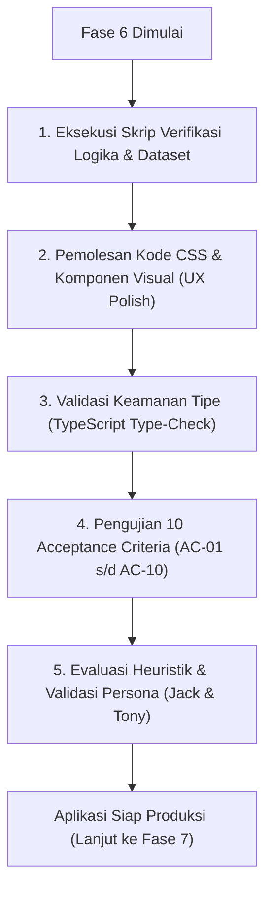

# PANDUAN IMPLEMENTASI TEKNIS — FASE 6: UX POLISH, HEURISTIC EVALUATION, & ACCEPTANCE TESTING
## Calosa Laptop & Gadget Store (Web Catalog & Comparison Experience)

Dokumen ini berisi panduan teknis langkah demi langkah (*step-by-step implementation guide*) beserta seluruh kode penyempurnaan visual (*UX polish*), skrip verifikasi otomatis, evaluasi heuristik, dan pengujian menyeluruh terhadap 10 kriteria penerimaan (**AC-01 s/d AC-10**) berdasarkan **PRD v2.0**.

---

## 🎯 Tujuan & Cakupan Masalah Fase 6

Fase 6 merupakan tahap pemolesan akhir dan penjaminan mutu antarmuka (*quality assurance*) sebelum persiapan rilis. Fokus utama fase ini mencakup:
1. **Pemolesan UX & Visual (*UX Polish*):** Memastikan konsistensi tipografi, hierarki warna kontras tinggi (WCAG AA), transisi mikro-interaksi (*smooth hover & transitions*), *custom scrollbar* pada daftar filter, serta perataan *layout* *Desktop-First* ($\ge 1280\text{px}$).
2. **Evaluasi 10 Heuristik Usabilitas Nielsen:** Menguji apakah seluruh perbaikan antarmuka telah mengatasi kendala yang dilaporkan pada *Worksheet 1* dan 5 responden (R1–R5).
3. **Skrip Verifikasi Otomatis Logika & Dataset:** Membuat skrip pengujian berbasis TypeScript untuk memvalidasi skema data, skenario *missing data*, pemisahan kategori eksak, dan logika perbandingan secara otomatis.
4. **Validasi Menyeluruh Kriteria Penerimaan (AC-01 s/d AC-10):** Menjalankan matriks pengujian fungsional terpadu untuk memastikan seluruh kebutuhan PRD terpenuhi tanpa cacat.
5. **Pengujian Berbasis Persona (Jack & Tony):** Memverifikasi kenyamanan penggunaan aplikasi dari sudut pandang pembeli teknis maupun pembeli awam.

---

## 📐 Alur Pengujian & Penyempurnaan Sistem



---

## 📁 Berkas yang Dibuat & Dimodifikasi pada Fase 6

| Berkas | Peran | Tindakan |
| :--- | :--- | :--- |
| `resources/css/app.css` | Menambahkan utilitas styling custom scrollbar, animasi halus, dan perataan kontras | **Modifikasi** |
| `scripts/verify-acceptance-criteria.ts` | Skrip eksekusi verifikasi otomatis untuk logika filter, dataset dummy, dan AC PRD | **Baru** |
| `package.json` | Menambahkan perintah pintas *npm script* untuk menjalankan verifikasi otomatis | **Modifikasi** |

---

## 💻 Kode Lengkap & Penjelasan Komponen

### Langkah 1: Pemolesan Gaya Global & Mikro-Interaksi (`resources/css/app.css`)

Tambahkan styling utilitas untuk *custom scrollbar* di sidebar filter merek, animasi *toast alert*, transisi kartu produk, dan kenyamanan visual layar desktop.

📁 **Path:** `resources/css/app.css`

```css
@import "tailwindcss";

@layer utilities {
  /* Scrollbar Kustom Halus untuk Filter Merek (UX-01) */
  .custom-scrollbar::-webkit-scrollbar {
    width: 5px;
  }
  .custom-scrollbar::-webkit-scrollbar-track {
    background: #f1f5f9;
    border-radius: 9999px;
  }
  .custom-scrollbar::-webkit-scrollbar-thumb {
    background: #cbd5e1;
    border-radius: 9999px;
  }
  .custom-scrollbar::-webkit-scrollbar-thumb:hover {
    background: #94a3b8;
  }

  /* Animasi Masuk Halus */
  @keyframes fadeIn {
    from {
      opacity: 0;
      transform: translateY(-6px);
    }
    to {
      opacity: 1;
      transform: translateY(0);
    }
  }

  @keyframes slideUp {
    from {
      opacity: 0;
      transform: translate(-50%, 20px);
    }
    to {
      opacity: 1;
      transform: translate(-50%, 0);
    }
  }

  .animate-fadeIn {
    animation: fadeIn 0.2s cubic-bezier(0.16, 1, 0.3, 1) forwards;
  }

  .animate-slideUp {
    animation: slideUp 0.3s cubic-bezier(0.16, 1, 0.3, 1) forwards;
  }
}
```

---

### Langkah 2: Skrip Otomatisasi Verifikasi Kriteria Penerimaan (`verify-acceptance-criteria.ts`)

Buat skrip pengujian berbasis TypeScript di direktori `scripts/verify-acceptance-criteria.ts` untuk menguji integritas dataset dan logika inti aplikasi secara otomatis:
* Memvalidasi ketersediaan minimal 12–16 produk.
* Memvalidasi skenario *missing data* (minimal 2 produk tanpa gambar, minimal 2 produk tanpa garansi/deskripsi).
* Memvalidasi ketepatan klasifikasi 4 kategori resmi (`Laptop`, `Komponen PC`, `Aksesoris`, `Tablet & Wearable`).
* Memvalidasi kelengkapan 3 cabang resmi.
* Menguji batas logika pemilihan perbandingan maksimal 3 produk.

📁 **Path:** `scripts/verify-acceptance-criteria.ts`

```typescript
import { DUMMY_PRODUCTS, CATEGORIES, BRANCHES } from '../resources/js/data/dummyProducts';
import { Product } from '../resources/js/types/product';

console.log('========================================================');
console.log('🔍 MENJALANKAN VERIFIKASI LOGIKA & ACCEPTANCE CRITERIA');
console.log('   Calosa Laptop & Gadget Store — PRD v2.0');
console.log('========================================================\n');

let passCount = 0;
let failCount = 0;

function assert(condition: boolean, testName: string, detail?: string) {
  if (condition) {
    console.log(`✅ [PASS] ${testName}`);
    passCount++;
  } else {
    console.error(`❌ [FAIL] ${testName}`);
    if (detail) console.error(`   👉 Detail: ${detail}`);
    failCount++;
  }
}

// 1. Uji Kelengkapan Dataset Dummy (Bab 4 PRD)
assert(
  DUMMY_PRODUCTS.length >= 12 && DUMMY_PRODUCTS.length <= 20,
  'Kuantitas Dummy Data Memenuhi Syarat (12–20 produk)',
  `Total produk saat ini: ${DUMMY_PRODUCTS.length}`
);

// 2. Uji Skenario Missing Image (FR-07, AC-06)
const missingImageProducts = DUMMY_PRODUCTS.filter((p) => p.imageUrl === null);
assert(
  missingImageProducts.length >= 2,
  'Minimal 2 Produk Tanpa Gambar (Uji Placeholder Fallback)',
  `Ditemukan ${missingImageProducts.length} produk tanpa gambar (${missingImageProducts.map((p) => p.name).join(', ')})`
);

// 3. Uji Skenario Missing Warranty / Description (FR-07, AC-06)
const missingWarrantyProducts = DUMMY_PRODUCTS.filter((p) => p.warranty === null);
const missingDescProducts = DUMMY_PRODUCTS.filter((p) => p.description === null);
assert(
  missingWarrantyProducts.length >= 1 && missingDescProducts.length >= 1,
  'Minimal Ada Produk Tanpa Garansi dan Tanpa Deskripsi (Uji Graceful Fallback)',
  `Tanpa garansi: ${missingWarrantyProducts.length}, Tanpa deskripsi: ${missingDescProducts.length}`
);

// 4. Uji Pemisahan Kategori Ketat (FR-02, AC-02)
assert(
  CATEGORIES.length === 4,
  'Tepat Ada 4 Kategori Resmi Terpisah',
  `Kategori: ${CATEGORIES.join(', ')}`
);

const invalidCategories = DUMMY_PRODUCTS.filter(
  (p) => !CATEGORIES.includes(p.category as any)
);
assert(
  invalidCategories.length === 0,
  'Semua Produk Terpetakan ke Kategori yang Sah (Tidak Ada Kategori Liar)',
  invalidCategories.length > 0 ? `Ditemukan kategori tidak valid pada: ${invalidCategories.map((p) => p.name).join(', ')}` : undefined
);

// Uji bahwa tidak ada smartwatch yang nyasar ke kategori Laptop
const smartwatchInLaptop = DUMMY_PRODUCTS.filter(
  (p) => p.category === 'Laptop' && (p.name.toLowerCase().includes('watch') || p.name.toLowerCase().includes('jam'))
);
assert(
  smartwatchInLaptop.length === 0,
  'Kategori Laptop Murni (Tidak Tercampur Wearable/Smartwatch)',
  smartwatchInLaptop.length > 0 ? `Ditemukan: ${smartwatchInLaptop.map((p) => p.name).join(', ')}` : undefined
);

// 5. Uji Validitas Cabang Toko (FR-03, AC-03)
assert(
  BRANCHES.length === 3,
  'Tepat 3 Lokasi Cabang Toko Resmi',
  `Cabang: ${BRANCHES.join(', ')}`
);

const invalidBranchProducts = DUMMY_PRODUCTS.filter((p) =>
  p.branches.some((b) => !BRANCHES.includes(b as any))
);
assert(
  invalidBranchProducts.length === 0,
  'Semua Cabang Toko Memiliki Label Lengkap dan Sah',
  invalidBranchProducts.length > 0 ? `Cabang tidak valid pada produk: ${invalidBranchProducts.map((p) => p.name).join(', ')}` : undefined
);

// 6. Uji Logika Pembatas Maksimal 3 Produk Perbandingan (FR-08, AC-08)
const mockCompareList: Product[] = [];
function mockAddCompare(product: Product): { success: boolean; message?: string } {
  if (mockCompareList.length >= 3) {
    return { success: false, message: 'Maksimal 3 produk dapat dibandingkan sekaligus.' };
  }
  mockCompareList.push(product);
  return { success: true };
}

mockAddCompare(DUMMY_PRODUCTS[0]);
mockAddCompare(DUMMY_PRODUCTS[1]);
mockAddCompare(DUMMY_PRODUCTS[2]);
const fourthAttempt = mockAddCompare(DUMMY_PRODUCTS[3]);

assert(
  mockCompareList.length === 3 && fourthAttempt.success === false,
  'Pencegahan Produk ke-4 Berfungsi dan Memberikan Pesan Pembatas',
  `Status: success=${fourthAttempt.success}, message="${fourthAttempt.message}"`
);

// 7. Uji Format Spesifikasi Kunci & Full Specs (FR-05, FR-06)
const productsWithIncompleteSpecs = DUMMY_PRODUCTS.filter(
  (p) => p.highlightSpecs.length === 0 || Object.keys(p.fullSpecs).length === 0
);
assert(
  productsWithIncompleteSpecs.length === 0,
  'Semua Produk Memiliki Highlight Specs dan Full Specs Terstruktur',
  productsWithIncompleteSpecs.length > 0 ? `Produk tanpa specs: ${productsWithIncompleteSpecs.map((p) => p.name).join(', ')}` : undefined
);

console.log('\n========================================================');
console.log(`📊 HASIL PENGUJIAN OTOMATIS:`);
console.log(`   Total Lulus: ${passCount}`);
console.log(`   Total Gagal: ${failCount}`);
console.log('========================================================');

if (failCount > 0) {
  process.exit(1);
} else {
  console.log('🎉 SELURUH ATURAN PRD & CRITERIA LOGIKA LOLOS VALIDASI!');
}
```

---

### Langkah 3: Penambahan Script Pengujian di `package.json`

Tambahkan script runner pada `package.json` agar pengujian dapat dipanggil kapan saja dengan mudah:

📁 **Path:** `package.json`

```json
"scripts": {
    "build": "vp build",
    "build:ssr": "vp build && vp build --ssr",
    "dev": "vp dev",
    "check": "vp check",
    "check:fix": "vp check --fix",
    "types:check": "tsc --noEmit",
    "test:ac": "npx tsx scripts/verify-acceptance-criteria.ts"
}
```

Cara menjalankan pengujian otomatis di terminal:
```bash
npm.cmd run test:ac
```

---

## 📋 Matriks Verifikasi Komprehensif 10 Acceptance Criteria (AC-01 s/d AC-10)

Lakukan pengujian antarmuka secara langsung di peramban (`http://127.0.0.1:8000`) mengikuti panduan verifikasi berikut:

| ID | Kriteria Penerimaan PRD | Skenario Pengujian Antarmuka | Langkah Uji Manual | Ekspektasi Hasil | Status |
| :---: | :--- | :--- | :--- | :--- | :---: |
| **AC-01** | **Unified Search & Autocomplete** | Verifikasi satu search bar dan saran otomatis. | 1. Periksa header di semua halaman.<br>2. Ketik "ro" pada kotak pencarian.<br>3. Tekan tombol *Enter*. | • Hanya ada 1 search bar di header.<br>• Muncul dropdown berisi saran & maks. 4 preview produk.<br>• Daftar katalog langsung tersaring. | [ ] |
| **AC-02** | **Kategori Eksak** | Menghindari tercampurnya kategori produk. | 1. Centang kategori `Tablet & Wearable`.<br>2. Periksa produk yang tampil. | • Hanya muncul tablet dan smartwatch.<br>• Tidak ada laptop, RAM, mouse, atau charger yang tercampur. | [ ] |
| **AC-03** | **Filter Realtime & Label Cabang Lengkap** | Opsi cabang berlabel lengkap dan filter instan. | 1. Centang `Calosa Surabaya (Hi-Tech Mall)`.<br>2. Periksa teks label cabang. | • Nama cabang tertulis lengkap dengan alamat.<br>• Hasil terfilter seketika tanpa perlu tombol "Apply" terpisah. | [ ] |
| **AC-04** | **Input Rentang Harga Min & Maks** | Input harga dengan debounce dan format jelas. | 1. Isi "Harga Minimum" = 1.000.000.<br>2. Isi "Harga Maksimum" = 5.000.000. | • Label "Harga Minimum" dan "Harga Maksimum" tampak eksplisit.<br>• Produk dengan harga di luar rentang otomatis tersembunyi. | [ ] |
| **AC-05** | **Chip Filter Aktif & Reset Semua** | Transparansi filter aktif dan tombol reset. | 1. Aktifkan filter kategori dan harga.<br>2. Hapus salah satu chip via tombol (X).<br>3. Klik "Reset Semua Filter". | • Filter aktif tampil sebagai tag/chip.<br>• Chip dapat ditutup satu per satu.<br>• Tombol reset mengembalikan semua produk secara instan. | [ ] |
| **AC-06** | **Graceful Fallback Missing Data** | Penanganan data produk yang tidak lengkap. | 1. Buka katalog & cari produk `Acer Swift Go 14` dan `Thermal Grizzly`.<br>2. Buka halaman detail masing-masing. | • Tidak ada gambar rusak (*broken image*), tampil icon & teks *"Gambar belum tersedia"*.<br>• Tampil keterangan *"Informasi garansi belum dicantumkan"*. | [ ] |
| **AC-07** | **Pencatatan Status Compare Dua Arah** | Menambah perbandingan dari katalog dan detail. | 1. Klik "+ Bandingkan" di kartu katalog.<br>2. Buka halaman detail produk lain lalu klik "+ Tambah ke Perbandingan". | • Tombol langsung berganti status visual menjadi "Terpilih ✓".<br>• Status tersinkronisasi penuh antara katalog dan detail. | [ ] |
| **AC-08** | **Batas Maksimal 3 Produk & Peringatan Toast** | Mencegah penambahan produk ke-4. | 1. Pilih 3 produk ke dalam perbandingan.<br>2. Coba tambahkan produk ke-4. | • Sistem menolak produk ke-4.<br>• Muncul notifikasi toast: *"Maksimal 3 produk dapat dibandingkan sekaligus"*. | [ ] |
| **AC-09** | **Tabel Perbandingan 3 Kolom Sejajar & Sorot Selisih** | Evaluasi perbandingan berdampingan. | 1. Buka halaman `/compare` dengan 3 produk.<br>2. Centang "Soroti Perbedaan Spesifikasi". | • 3 Kolom tersusun rapi berdampingan dengan baris atribut sejajar.<br>• Baris yang nilainya berbeda diberi warna latar aksen khusus.<br>• Atribut beda kategori menampilkan `—`. | [ ] |
| **AC-10** | **Compare Empty & Partial State** | Mengatasi broken empty state pada halaman perbandingan. | 1. Buka `/compare` saat 0 produk dipilih.<br>2. Pilih 1 produk lalu buka `/compare`. | • Saat 0 produk: Tampil ilustrasi ramah dan tombol CTA *"Pilih Produk di Katalog"*.<br>• Saat 1 produk: Kolom 2 & 3 menampilkan slot kartu interaktif *"+ Tambah Produk Pembanding"*. | [ ] |

---

## 👥 Skenario Pengujian Berdasarkan Persona Pengguna

### Persona 1: Jack (*Tech-Oriented Buyer*)
* **Karakteristik:** Sangat teliti pada spesifikasi teknis, harga, garansi resmi, dan ketersediaan stok fisik cabang.
* **Skenario Evaluasi:**
  1. Jack mencari *"RAM"* atau *"SSD"* melalui Search Bar utama.
  2. Jack membuka detail produk *Samsung 990 PRO SSD* untuk membaca tabel spesifikasi teknis bergaris selang-seling (*zebra striping*).
  3. Jack memasukkan produk tersebut dan *Corsair Vengeance RAM* ke dalam daftar perbandingan.
  4. Pada halaman perbandingan berdampingan, Jack mengaktifkan toggle *"Soroti Perbedaan Spesifikasi"* untuk mengecek selisih *read/write speed*, *form factor*, dan status garansi antar komponen.
* **Kriteria Keberhasilan Jack:** Data spesifikasi tidak terpotong, tabel mudah dipindai secara horizontal, dan status ketersediaan cabang Malang Panjaitan terbaca jelas.

### Persona 2: Tony (*Clarity-Oriented Buyer*)
* **Karakteristik:** Pembeli umum yang mengutamakan kejelasan navigasi, tidak ingin bingung dengan menu yang rusak atau hasil pencarian yang melenceng.
* **Skenario Evaluasi:**
  1. Tony melihat bahwa di header hanya ada 1 search bar yang bersih dan jelas.
  2. Tony mengetik *"Lap"* dan langsung melihat 4 pratinjau laptop di dropdown autocomplete.
  3. Tony mencoba mencentang filter cabang *"Calosa Malang (Soekarno Hatta)"* dan melihat daftar laptop langsung terfilter seketika tanpa perlu mencari tombol *apply*.
  4. Tony mengklik tombol "+ Bandingkan" dan melihat tombol langsung berubah menjadi hijau bertuliskan "Terpilih ✓", serta bilah mengambang di bawah layar memberitahukan bahwa 1 dari 3 slot telah terisi.
  5. Tony membuka halaman perbandingan saat belum ada produk dan tidak menemukan halaman kosong yang rusak, melainkan panduan 3 langkah yang ramah.
* **Kriteria Keberhasilan Tony:** Tidak ada rasa bingung, navigasi stabil dan dapat diprediksi (*predictable UX*).

---

## 🛠️ Checklist Kesiapan Masuk Fase 7 (Final Polish & Deployment)

Sebelum melangkah ke Fase 7, pastikan seluruh item berikut telah tercentang:
- [ ] Skrip `npm.cmd run test:ac` dijalankan dan menghasilkan **100% PASS**.
- [ ] Type-check TypeScript (`npx tsc --noEmit`) berjalan bersih tanpa error tipe.
- [ ] Seluruh pengujian checklist `AC-01` s/d `AC-10` telah diverifikasi secara visual pada peramban.
- [ ] Skenario persona Jack dan Tony telah diuji dan tidak ditemukan *usability flaw*.
