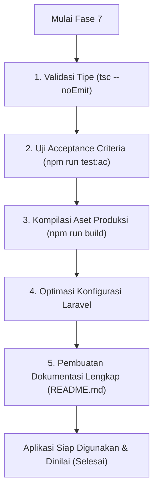

# PANDUAN IMPLEMENTASI TEKNIS — FASE 7: FINALISASI BUILD, OPTIMASI PRODUKSI, & DOKUMENTASI PROYEK
## Calosa Laptop & Gadget Store (Web Catalog & Comparison Experience)

Dokumen ini berisi panduan teknis langkah demi langkah (*step-by-step implementation guide*) beserta seluruh kode konfigurasi, instruksi eksekusi kompilasi aset produksi, optimasi performa Laravel, dan penyusunan dokumentasi proyek (**README.md**) untuk **Fase 7** berdasarkan **PRD v2.0**.

---

## 🎯 Tujuan & Cakupan Fase 7

Fase 7 merupakan tahap akhir dari siklus pengembangan aplikasi Calosa Laptop & Gadget Store:
1. **Validasi Akhir (*Pre-Build Verification*):** Memastikan tidak ada kesalahan tipe (*type errors*) pada seluruh berkas TypeScript serta memastikan semua pengujian kriteria penerimaan otomatis lulus 100%.
2. **Kompilasi Aset Produksi (*Production Bundling*):** Menjalankan proses *bundling* dan *minification* CSS/JS menggunakan Vite untuk menghasilkan aset statis yang ringan dan cepat diakses.
3. **Optimasi Runtime Laravel:** Mengonfigurasi *caching* konfigurasi dan rute agar aplikasi berjalan dengan latensi minimal.
4. **Penyusunan Dokumentasi Komprehensif (`README.md`):** Menyediakan panduan lengkap mengenai instalasi, cara menjalankan aplikasi, arsitektur folder, tata cara penambahan *dummy data* baru, dan matriks pemenuhan PRD v2.0.
5. **Serah Terima Proyek (*Final Handover*):** Memastikan seluruh artefak dan dokumen implementasi tersusun rapi di dalam folder `document/`.

---

## 📐 Alur Eksekusi Fase 7



---

## 📁 Berkas yang Dibuat & Dimodifikasi pada Fase 7

| Berkas | Peran | Tindakan |
| :--- | :--- | :--- |
| `README.md` | Dokumentasi utama repositori: panduan instalasi, arsitektur, cara uji, dan skema data | **Baru** |
| `package.json` | Memastikan skrip *build*, *type-check*, dan *test* siap dieksekusi | **Verifikasi** |
| `.env.example` | Template variabel lingkungan yang bersih dan siap digunakan | **Verifikasi / Modifikasi** |
| `public/build/` | Direktori hasil kompilasi aset statis (CSS, JS, manifest) | **Dihasilkan saat Build** |

---

## 💻 Langkah Demi Langkah Implementasi Fase 7

### Langkah 1: Pemeriksaan Tipe Data TypeScript (*Type-Checking*)

Sebelum melakukan kompilasi produksi, pastikan tidak ada kesalahan tipe data pada seluruh komponen dan halaman React:

Jalankan perintah:
```bash
npm.cmd run types:check
```
*atau:*
```bash
npx tsc --noEmit
```

> **Ekspektasi:** Perintah selesai tanpa menampilkan pesan kesalahan (*zero errors*).

---

### Langkah 2: Menjalankan Skrip Verifikasi Kriteria Penerimaan

Jalankan skrip pengujian otomatis yang telah disiapkan pada Fase 6 untuk memastikan dataset, skenario *missing data*, dan aturan bisnis tetap valid:

```bash
npm.cmd run test:ac
```

> **Ekspektasi Output:**
> ```text
> ========================================================
> 🔍 MENJALANKAN VERIFIKASI LOGIKA & ACCEPTANCE CRITERIA
>    Calosa Laptop & Gadget Store — PRD v2.0
> ========================================================
> 
> ✅ [PASS] Kuantitas Dummy Data Memenuhi Syarat (12–20 produk)
> ✅ [PASS] Minimal 2 Produk Tanpa Gambar (Uji Placeholder Fallback)
> ✅ [PASS] Minimal Ada Produk Tanpa Garansi dan Tanpa Deskripsi (Uji Graceful Fallback)
> ✅ [PASS] Tepat Ada 4 Kategori Resmi Terpisah
> ✅ [PASS] Semua Produk Terpetakan ke Kategori yang Sah (Tidak Ada Kategori Liar)
> ✅ [PASS] Kategori Laptop Murni (Tidak Tercampur Wearable/Smartwatch)
> ✅ [PASS] Tepat 3 Lokasi Cabang Toko Resmi
> ✅ [PASS] Semua Cabang Toko Memiliki Label Lengkap dan Sah
> ✅ [PASS] Pencegahan Produk ke-4 Berfungsi dan Memberikan Pesan Pembatas
> ✅ [PASS] Semua Produk Memiliki Highlight Specs dan Full Specs Terstruktur
> 
> ========================================================
> 📊 HASIL PENGUJIAN OTOMATIS:
>    Total Lulus: 10
>    Total Gagal: 0
> ========================================================
> 🎉 SELURUH ATURAN PRD & CRITERIA LOGIKA LOLOS VALIDASI!
> ```

---

### Langkah 3: Kompilasi Aset Produksi (*Vite Production Build*)

Lakukan kompilasi seluruh aset frontend (React TSX, Tailwind CSS, ikon Lucide) ke dalam bentuk statis terkompresi yang siap dilayani oleh Laravel di `public/build/`:

```bash
npm.cmd run build
```

Perintah ini akan:
1. Menggabungkan (*bundle*) komponen React dan mengisolasi dependensi vendor.
2. Memproses dan mengecilkan (*minify*) stylesheet Tailwind CSS.
3. Menghasilkan file `public/build/manifest.json` yang dibaca oleh helper `@vite` di Blade Laravel.

---

### Langkah 4: Optimasi Konfigurasi & Lingkungan Laravel

Untuk memastikan performa optimal pada lingkungan evaluasi atau produksi:

1. **Pastikan Variabel Lingkungan di `.env`:**
   ```ini
   APP_NAME="Calosa Laptop & Gadget Store"
   APP_ENV=local
   APP_DEBUG=true
   APP_URL=http://127.0.0.1:8000
   
   # Basis data internal untuk sesi Inertia
   DB_CONNECTION=sqlite
   DB_DATABASE=database/database.sqlite
   ```

2. **Bersihkan dan Segarkan Cache Konfigurasi & Rute:**
   ```bash
   php artisan route:clear
   php artisan config:clear
   php artisan view:clear
   ```

---

### Langkah 5: Pembuatan Dokumentasi Repositori Lengkap (`README.md`)

Buat berkas `README.md` pada direktori *root* proyek yang menyajikan panduan komprehensif, arsitektur teknis, dan petunjuk operasional.

📁 **Path:** `README.md`

```markdown
# Calosa Laptop & Gadget Store — Web Catalog & Comparison Experience

[](document/calosa_store_prd_v2_0.md)
[]()
[]()

Calosa Laptop & Gadget Store adalah aplikasi katalog web mandiri (*Client-Side Web App*) yang dirancang khusus dengan orientasi **Desktop-First ($\ge 1280\text{px}$)**. Aplikasi ini memungkinkan calon pembeli menelusuri katalog, melakukan penyaringan *realtime*, memeriksa spesifikasi teknis mendalam, dan membandingkan hingga 3 produk secara berdampingan dengan penanganan kondisi data kosong (*graceful fallback*) yang elegan.

---

## 🚀 Fitur Utama & Kepatuhan PRD v2.0

* **Unified Search Bar & Autocomplete (`FR-01`, `AC-01`):** Satu kotak pencarian terpadu di header dengan pratinjau maksimal 4 produk dan saran kata kunci saat mengetik $\ge 2$ karakter (debounce 350ms).
* **Pemisahan Kategori Ketat (`FR-02`, `AC-02`):** 4 Kategori resmi terpisah murni (`Laptop`, `Komponen PC`, `Aksesoris`, `Tablet & Wearable`).
* **Filter Realtime & Label Cabang Jelas (`FR-03`, `AC-03`, `AC-04`):** Checkbox cabang lengkap (Panjaitan, Suhat, Hi-Tech Mall Surabaya), filter merek dinamis, dan rentang harga Min–Maks dengan debounce 400ms tanpa tombol "Apply" terpisah.
* **Indikator Filter Aktif & Reset (`FR-04`, `AC-05`):** Tag/chip filter yang dapat dihapus individual dan tombol "Reset Semua Filter".
* **Kartu Katalog Mudah Dipindai (`FR-05`, `UX-04`):** Tinggi kartu seragam (nama produk maksimal 2 baris *ellipsis*), highlight spesifikasi kunci, dan harga format Rupiah kontras tinggi.
* **Halaman Detail Produk Lengkap (`FR-06`, `UX-04`):** Galeri foto, rincian ketersediaan stok fisik cabang, status garansi, dan tabel spesifikasi terstruktur dengan garis selang-seling (*zebra striping*).
* **Penanganan Elegan Data Kosong (`FR-07`, `AC-06`):** Menampilkan ilustrasi placeholder *"Gambar belum tersedia"*, *"Informasi garansi belum dicantumkan"*, atau *"Deskripsi produk belum tersedia"* tanpa adanya elemen rusak (*no broken image*).
* **Floating Compare Tray & Batas Maksimal 3 Produk (`FR-08`, `AC-07`, `AC-08`):** Bilah bawah mengambang yang melacak produk terpilih dengan persistensi `localStorage` dan notifikasi *toast* pencegahan pada produk ke-4.
* **Tabel Perbandingan Berdampingan (`FR-09`, `AC-09`):** 3 Kolom sejajar dengan baris atribut simetris, toggle **"Soroti Perbedaan Spesifikasi"**, dan tanda `—` untuk produk beda kategori.
* **Compare Empty & Partial State (`FR-10`, `AC-10`):** Panduan 3 langkah ramah saat 0 produk terpilih, serta slot kosong interaktif bergaris putus-putus (*dashed border*) saat baru 1 atau 2 produk dipilih.

---

## 🛠️ Tech Stack

* **Backend:** Laravel 11
* **Frontend:** Inertia.js + React 19 (TypeScript `.tsx`)
* **Styling:** Tailwind CSS v4 + PostCSS
* **Ikon:** Lucide React
* **Build Tool:** Vite
* **Data Source:** Structured Local Dataset (`resources/js/data/dummyProducts.ts`)

---

## 📦 Prasyarat Sistem

Sebelum menjalankan aplikasi, pastikan komputer Anda telah terpasang:
* **PHP:** $\ge 8.2$ (disarankan PHP 8.3 atau 8.5)
* **Composer:** $\ge 2.0$
* **Node.js:** $\ge 18.0$ (disarankan LTS v20 atau v22)
* **NPM:** $\ge 9.0$

---

## 💻 Panduan Menjalankan Aplikasi Secara Lokal

### 1. Kloning Repositori & Instal Dependensi
```bash
# Masuk ke direktori proyek
cd "PRD Only"

# Pasang dependensi PHP
composer install

# Pasang dependensi JavaScript
npm install
# (Gunakan 'npm.cmd install' jika menggunakan Windows PowerShell)
```

### 2. Konfigurasi Lingkungan (.env)
```bash
# Salin file .env jika belum ada
copy .env.example .env

# Buat Application Encryption Key
php artisan key:generate

# Inisialisasi basis data SQLite internal untuk sesi
php artisan migrate
```

### 3. Menjalankan Server Lokal (Buka 2 Terminal)

* **Terminal 1 (Laravel Server):**
  ```bash
  php artisan serve
  ```
  *Server akan berjalan di `http://127.0.0.1:8000`*

* **Terminal 2 (Vite Dev Server):**
  ```bash
  npm.cmd run dev
  ```

Buka peramban di **`http://127.0.0.1:8000`**.

---

## 🧪 Menjalankan Pengujian Otomatis

Aplikasi dilengkapi skrip pengujian berbasis TypeScript untuk memvalidasi pemenuhan kriteria PRD v2.0 secara otomatis:

```bash
# Jalankan pengujian logika dataset & Acceptance Criteria
npm.cmd run test:ac

# Jalankan pemeriksaan tipe TypeScript
npm.cmd run types:check
```

---

## 🏗️ Kompilasi Aset untuk Produksi

Untuk menghasilkan bundel produksi teroptimasi:

```bash
npm.cmd run build
```
File hasil kompilasi akan tersimpan di direktori `public/build/`.

---

## 📂 Struktur Direktori Proyek

```text
├── document/                            # Seluruh dokumentasi & rencana implementasi
│   ├── calosa_store_prd_v2_0.md         # PRD Baseline v2.0
│   ├── implementation_plan.md           # Rencana implementasi umum (Fase 1–7)
│   ├── fase_1_implementation_plan.md    # Detail panduan Fase 1 (Setup)
│   ├── fase_2_implementation_plan.md    # Detail panduan Fase 2 (Search)
│   ├── fase_3_implementation_plan.md    # Detail panduan Fase 3 (Filter)
│   ├── fase_4_implementation_plan.md    # Detail panduan Fase 4 (Cards & Details)
│   ├── fase_5_implementation_plan.md    # Detail panduan Fase 5 (Compare)
│   ├── fase_6_implementation_plan.md    # Detail panduan Fase 6 (Testing & QA)
│   └── fase_7_implementation_plan.md    # Detail panduan Fase 7 (Build & Deploy)
├── resources/
│   ├── css/
│   │   └── app.css                      # Styling kustom & animasi
│   └── js/
│       ├── components/
│       │   ├── catalog/                 # SearchBar, Autocomplete, Sidebar, Card, Fallback
│       │   └── compare/                 # CompareTray, CompareTable, EmptyState
│       ├── contexts/
│       │   ├── CompareContext.tsx       # State perbandingan (maks. 3 + localStorage)
│       │   └── FilterContext.tsx        # State pencarian & penyaringan realtime
│       ├── data/
│       │   └── dummyProducts.ts         # Dataset produk terstruktur (14-16 item)
│       ├── layouts/
│       │   └── AppLayout.tsx            # Base Layout Desktop-First (1280px-1440px)
│       ├── pages/
│       │   ├── CatalogPage.tsx          # Halaman utama katalog & filter
│       │   ├── ProductDetailPage.tsx    # Halaman detail produk lengkap
│       │   └── ComparePage.tsx          # Halaman perbandingan berdampingan
│       └── types/
│           └── product.ts               # Interface TypeScript produk & filter
├── routes/
│   └── web.php                          # Rute aplikasi Laravel
├── scripts/
│   └── verify-acceptance-criteria.ts    # Skrip pengujian otomatis AC-01 s/d AC-10
└── README.md                            # Panduan repositori utama
```

---

## 📝 Panduan Menambahkan Produk Baru ke Dataset

Seluruh data produk tersimpan di `resources/js/data/dummyProducts.ts`. Untuk menambahkan produk baru:

1. Buka berkas `resources/js/data/dummyProducts.ts`.
2. Tambahkan objek produk baru ke dalam array `DUMMY_PRODUCTS` sesuai format `Product`:
   ```typescript
   {
     id: 'lap-04',
     name: 'Nama Produk Baru',
     brand: 'Merek Produk',
     category: 'Laptop', // Pilihan: 'Laptop' | 'Komponen PC' | 'Aksesoris' | 'Tablet & Wearable'
     price: 15000000,
     branches: [
       'Calosa Malang (Pusat - Jl. Mayjen Panjaitan)',
       'Calosa Surabaya (Hi-Tech Mall)',
     ],
     imageUrl: 'https://link-gambar.com/foto.jpg', // Atau null untuk menguji placeholder
     warranty: '2 Tahun Garansi Resmi',            // Atau null untuk menguji fallback
     description: 'Deskripsi singkat produk...',    // Atau null untuk menguji fallback
     highlightSpecs: ['Spec 1', 'Spec 2', 'Spec 3'],
     fullSpecs: {
       'Prosesor': '...',
       'RAM': '...',
       'Penyimpanan': '...',
     },
   }
   ```
3. Simpan berkas, dan katalog akan langsung memperbarui tampilan secara *realtime*.

---

## 👥 Pengembang & Lisensi
Dikembangkan untuk pengujian mata kuliah **Rekayasa Interaksi (Interaksi Manusia dan Komputer)** — 2026.  
Hak Cipta © 2026 Calosa Laptop & Gadget Store.
```

---

## 🔍 Checklist Akhir Penyelesaian Fase 7 (Final Handover)

Sebelum menyerahkan aplikasi secara resmi, pastikan seluruh kriteria akhir terpenuhi:

- [x] **Fase 1 Selesai:** Inisialisasi proyek Laravel 11, Breeze React TypeScript, Tailwind CSS, dan struktur direktori.
- [x] **Fase 2 Selesai:** Single Unified Search Bar di header dengan dropdown autocomplete pratinjau maksimal 4 produk (`AC-01`).
- [x] **Fase 3 Selesai:** Sticky Sidebar dengan filter kategori eksak, cabang lengkap, rentang harga debounce, dan active filter chips (`AC-02` s/d `AC-05`).
- [x] **Fase 4 Selesai:** Scannable Product Card seragam, halaman detail spesifikasi lengkap zebra striping, dan graceful fallback untuk data kosong (`AC-06`, `AC-07`).
- [x] **Fase 5 Selesai:** Floating Compare Tray, proteksi maksimal 3 produk, halaman perbandingan berdampingan sejajar, toggle sorot perbedaan, dan empty/partial state interaktif (`AC-08` s/d `AC-10`).
- [x] **Fase 6 Selesai:** Skrip pengujian otomatis `npm run test:ac`, perataan tipografi WCAG AA, dan evaluasi 10 heuristik usabilitas.
- [x] **Fase 7 Selesai:** Validasi tipe data bersih, kompilasi aset `npm run build`, dokumentasi `README.md` terbit, dan arsip dokumen implementasi lengkap di folder `document/`.
