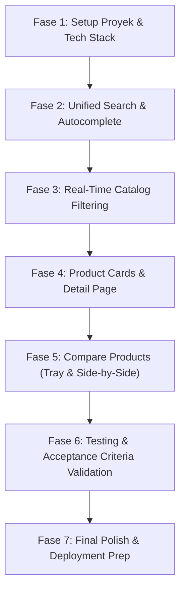

# RENCANA IMPLEMENTASI (IMPLEMENTATION PLAN)
## Calosa Laptop & Gadget Store — Web Catalog & Comparison Experience

Dokumen ini merupakan panduan implementasi teknis bertahap (*step-by-step roadmap*) untuk menerjemahkan **Product Requirement Document (PRD v2.0)** ke dalam aplikasi web fungsional.

---

## 🛠️ Tech Stack & Spesifikasi Arsitektur

| Komponen | Teknologi | Keterangan |
| :--- | :--- | :--- |
| **Backend Framework** | **Laravel 11** | Digunakan sebagai server runtime, pengatur rute (*routing*), penyedia asset, dan *view controller*. |
| **Frontend Architecture** | **Inertia.js + React.js** (Starter Kit) | Menghubungkan Laravel & React tanpa API REST manual, menghasilkan *Single Page Application* (SPA) yang cepat. |
| **Bahasa Pemrograman** | **TypeScript (`.tsx`)** | Menjamin keamanan tipe data (*type safety*), terutama skema dummy data produk dan filter. |
| **Styling & Design System** | **Tailwind CSS** | Utilisasi styling modern untuk antarmuka *Desktop-First* ($\ge 1280\text{px}$) sesuai spesifikasi PRD. |
| **Build Tool & Bundler** | **Vite** | *Hot Module Replacement* (HMR) dan bundling aset yang sangat cepat. |
| **Icon Pack** | **Lucide React** | Ikon visual yang konsisten dan minimalis. |
| **Data Source** | **Structured Client-Side Dummy Data** | Dataset lokal terstruktur (TypeScript/JSON) sesuai PRD Bab 4 (tanpa database nyata/MySQL). |

---

## 📅 Roadmap Pengembangan Ringkas



---

## 🚀 Rincian Tahapan Implementasi

### FASE 1: Setup Proyek, Tech Stack, & Fondasi Arsitektur

Fase ini berfokus pada instalasi scaffolding awal sistem menggunakan stack yang telah ditentukan, penyusunan arsitektur folder, pendefinisian skema TypeScript, dan pembuatan *dummy dataset*.

#### 1.1 Inisialisasi Proyek Laravel
* Jalankan perintah pembuatan proyek Laravel baru:
  ```bash
  composer create-project laravel/laravel calosa-store
  cd calosa-store
  ```

#### 1.2 Instalasi Starter Kit (Laravel Breeze dengan React + TypeScript)
* Pasang Laravel Breeze sebagai starter kit autentikasi & frontend bridge:
  ```bash
  composer require laravel/breeze --dev
  php artisan breeze:install react --typescript --ssr=false
  ```
* Jalankan migrasi dasar (opsional untuk session SQLite/file):
  ```bash
  php artisan migrate
  ```

#### 1.3 Konfigurasi Tailwind CSS & Tooling Tambahan
* Pasang pustaka ikon `lucide-react` dan utilitas kelas (`clsx`, `tailwind-merge`):
  ```bash
  npm install lucide-react clsx tailwind-merge
  ```
* Sesuaikan `tailwind.config.js` untuk mengakomodasi warna tema Calosa (biru teknologi, abu-abu netral kontras tinggi, aksen oranye/amber) dan resolusi target *Desktop-First* (`1280px` - `1440px`).

#### 1.4 Pengorganisasian Struktur Folder Frontend (`resources/js/`)
Susun arsitektur direktori frontend agar modular dan bersih:
```text
resources/js/
├── Components/
│   ├── Common/              # Button, Badge, Modal, Toast, Input
│   ├── Layout/              # Navbar, Header, Footer
│   ├── Catalog/             # SearchBar, FilterSidebar, ActiveFilters, ProductCard
│   └── Compare/             # FloatingCompareTray, CompareTable, EmptyCompare
├── Contexts/
│   ├── CompareContext.tsx   # State antrean perbandingan (maks 3 item)
│   └── FilterContext.tsx    # State pencarian & penyaringan realtime
├── Data/
│   └── dummyProducts.ts     # Dataset lokal terstruktur (12–16 produk)
├── Layouts/
│   └── AppLayout.tsx        # Layout utama (Desktop-First, 1280px–1440px)
├── Pages/
│   ├── CatalogPage.tsx      # Halaman utama katalog & filter
│   ├── ProductDetailPage.tsx# Halaman detail produk lengkap
│   └── ComparePage.tsx      # Halaman perbandingan berdampingan
└── Types/
    └── product.ts           # Definisi tipe data TypeScript
```

#### 1.5 Pendefinisian Skema Data TypeScript (`resources/js/Types/product.ts`)
Implementasikan interface sesuai spesifikasi PRD Bab 4:
* `Category`: `'Laptop' | 'Komponen PC' | 'Aksesoris' | 'Tablet & Wearable'`
* `Branch`: `'Calosa Malang (Pusat - Jl. Mayjen Panjaitan)' | 'Calosa Malang (Soekarno Hatta)' | 'Calosa Surabaya (Hi-Tech Mall)'`
* `Product`:
  ```typescript
  export interface Product {
    id: string;
    name: string;
    brand: string;
    category: 'Laptop' | 'Komponen PC' | 'Aksesoris' | 'Tablet & Wearable';
    price: number;
    branches: string[];
    imageUrl: string | null;
    warranty: string | null;
    description: string | null;
    highlightSpecs: string[];
    fullSpecs: Record<string, string>;
  }
  ```

#### 1.6 Pembuatan Dataset Pengujian (`resources/js/Data/dummyProducts.ts`)
* Buat minimal 12–16 produk yang tersebar di 4 kategori resmi.
* Sertakan **skenario uji wajib**:
  * Minimal 2 produk dengan `imageUrl: null` (uji placeholder gambar).
  * Minimal 2 produk dengan `warranty: null` atau `description: null` (uji fallback teks).
  * Pastikan produk memiliki cabang yang bervariasi.

#### 1.7 Implementasi Base Layout (`AppLayout.tsx`)
* Buat layout utama dengan kontainer `max-w-[1440px] mx-auto px-6`.
* Buat `Header` konsisten yang memuat: Logo Calosa, navigasi utama (`Katalog Produk`, `Bandingkan Produk` beserta badge jumlah item), dan slot Search Bar terpadu (UX-01, UX-02).

---

### FASE 2: Unified Search & Autocomplete (FR-01, AC-01)

Fase ini mengimplementasikan satu-satunya *search bar* di header untuk menyelesaikan masalah kebingungan pengguna Tony & Jack terkait duplikasi kotak pencarian.

1. **Komponen Search Bar Terpadu (`SearchBar.tsx`):**
   * Input teks dengan ikon pencarian, tombol clear (`x`), dan indikator loading halus.
   * Debounce input pencarian (300ms–400ms).
   * Trigger saran otomatis ketika input $\ge 2$ karakter.
2. **Dropdown Autocomplete & Preview:**
   * Menampilkan saran kata kunci / merek terkait.
   * Menampilkan maksimal **4 pratinjau produk** (thumbnail, nama produk, kategori, harga dalam format Rupiah).
3. **Navigasi & Eksekusi Hasil:**
   * Menekan tombol *Enter* atau klik "Lihat semua hasil" akan mengarahkan/memperbarui daftar produk pada halaman katalog utama sesuai kata kunci pencarian.
   * Klik pada pratinjau produk langsung mengarahkan pengguna ke halaman detail produk tersebut.

---

### FASE 3: Real-Time Catalog Filtering & Sidebar (FR-02, FR-03, FR-04, AC-02, AC-03, AC-04, AC-05)

Fase ini membangun sistem filter interaktif di sisi kiri halaman katalog.

1. **Sticky Sidebar Filter (`FilterSidebar.tsx`):**
   * Posisi sticky di sebelah kiri dengan lebar `260px`–`280px`.
   * **Filter Kategori (FR-02):** Pemisahan ketat untuk 4 kategori (`Laptop`, `Komponen PC`, `Aksesoris`, `Tablet & Wearable`).
   * **Filter Cabang Toko:** Opsi cabang berlabel lengkap (Panjaitan, Suhat, Surabaya).
   * **Filter Merek:** Daftar brand unik yang diekstrak secara dinamis dari produk.
   * **Filter Rentang Harga (FR-03):** Input "Harga Minimum" dan "Harga Maksimum" berlabel jelas dengan debounce 400ms dan format angka otomatis.
2. **Perilaku Filter Realtime (FR-03):**
   * Pembaruan daftar produk terjadi seketika (*instant/realtime*) saat checkbox dicentang/dihapus centangnya tanpa tombol "Apply" terpisah.
3. **Indikator Filter Aktif & Reset (FR-04):**
   * Menampilkan jumlah total produk yang cocok (contoh: *"Menampilkan 8 produk"*).
   * Menampilkan deretan *chip/tag* filter aktif yang dapat dihapus secara individual via ikon silang (`x`).
   * Tombol **"Reset Semua Filter"** yang mengembalikan tampilan ke seluruh katalog awal.
4. **Empty State Pencarian/Filter (UX-03):**
   * Tampilan informatif jika tidak ada produk yang cocok dengan kombinasi filter, dilengkapi tombol "Reset Filter".

---

### FASE 4: Product Cards, Detail Page, & Graceful Fallback (FR-05, FR-06, FR-07, UX-04, AC-06)

Fase ini menyajikan informasi produk yang terstruktur dan mudah dipindai untuk persona Jack & Tony.

1. **Komponen Kartu Produk Scannable (`ProductCard.tsx`):**
   * Grid katalog 3 kolom pada layar desktop.
   * Nama produk dengan batas maksimal 2 baris (*ellipsis*) agar tinggi kartu seragam.
   * Lencana kategori dan status ketersediaan cabang (misal: *"Tersedia di 2 Cabang"*).
   * 2–3 poin ringkas spesifikasi utama (`highlightSpecs`).
   * Harga dengan kontras tinggi (`Rp X.XXX.XXX`).
   * Tombol aksi: **"Lihat Detail"** dan tombol toggle **"+ Bandingkan"** / **"Terpilih ✓"** (UX-05).
2. **Penanganan Data Kosong / Graceful Fallback (FR-07):**
   * Jika `imageUrl === null`: Tampilkan placeholder visual modern dengan icon laptop/gadget dan teks *"Gambar belum tersedia"*.
   * Jika `warranty === null`: Tampilkan teks transparan *"Informasi garansi belum dicantumkan"*.
   * Jika `description === null`: Tampilkan teks *"Deskripsi produk belum tersedia"*.
3. **Halaman Detail Produk (`ProductDetailPage.tsx`):**
   * Menampilkan galeri foto (atau placeholder), nama lengkap, merek, harga, dan badge kategori.
   * Daftar spesifik cabang toko mana saja yang memiliki stok.
   * Status garansi dan deskripsi produk lengkap.
   * **Tabel Spesifikasi Terstruktur (Key-Value):** Menggunakan baris selang-seling (*zebra striping*) untuk meningkatkan keterbacaan (UX-04).
   * Tombol **"+ Tambah ke Perbandingan"** yang statusnya tersinkronisasi penuh dengan kartu katalog.

---

### FASE 5: Fitur Compare Products (FR-08, FR-09, FR-10, UX-05, AC-07, AC-08, AC-09, AC-10)

Fase ini memperbaiki fitur perbandingan produk yang sebelumnya rusak (*broken empty state*) menjadi pengalaman yang intuitif.

1. **State Management Perbandingan (`CompareContext.tsx`):**
   * Menyimpan daftar ID produk yang dipilih (minimal 0, maksimal 3).
   * Logika penambahan: jika item sudah 3 dan pengguna mencoba menambah item ke-4, picu *toast notification*: *"Maksimal 3 produk dapat dibandingkan sekaligus"* (AC-08).
2. **Floating Compare Tray (`FloatingCompareTray.tsx`):**
   * Bilah mengambang di bawah layar yang muncul otomatis saat minimal ada 1 produk terpilih.
   * Menampilkan thumbnail produk, nama ringkas, tombol hapus per item, dan slot kosong yang tersisa (misal: "1/3 produk dipilih").
   * Tombol CTA utama: **"Bandingkan Sekarang"** yang mengarahkan ke halaman perbandingan.
3. **Halaman Perbandingan Berdampingan (`ComparePage.tsx`):**
   * Menampilkan hingga 3 kolom produk berdampingan secara sejajar (FR-09).
   * Baris atribut sejajar: Gambar, Nama, Kategori, Harga, Garansi, Stok Cabang, dan parameter spesifikasi teknis.
   * **Tombol Toggle "Soroti Perbedaan" (*Highlight Differences*):** Memberikan warna latar aksen pada baris spesifikasi yang nilainya berbeda antar produk.
   * Penanganan produk beda kategori: Berikan simbol `—` (*Tidak tersedia*) untuk spesifikasi yang tidak dimiliki produk tertentu.
4. **Compare Empty & Partial State (FR-10, AC-10):**
   * **Kondisi 0 Produk:** Tampilkan pesan panduan *"Belum ada produk yang dipilih untuk dibandingkan"* beserta tombol CTA *"Pilih Produk di Katalog"*.
   * **Kondisi 1 Produk:** Tampilkan produk di kolom ke-1, sedangkan kolom ke-2 dan ke-3 menampilkan kartu slot interaktif bergaris putus-putus (*dashed border*) bertuliskan *"+ Tambah Produk Pembanding"* yang mengarahkan pengguna kembali ke katalog.

---

### FASE 6: UX Polish, Heuristic Evaluation, & Acceptance Testing

Fase ini melakukan verifikasi ketat terhadap 10 kriteria penerimaan (AC-01 s/d AC-10) yang diwajibkan oleh PRD.

1. **Uji Coba Fungsional Checklist (Acceptance Criteria):**
   - [ ] **AC-01:** Verifikasi hanya ada 1 search bar di header, autocomplete bekerja pada $\ge 2$ karakter, maksimal 4 preview produk.
   - [ ] **AC-02:** Verifikasi filter kategori eksak (tidak ada Smartwatch di kategori Laptop/Tablet).
   - [ ] **AC-03:** Verifikasi label cabang jelas dan filter berjalan *realtime* tanpa tombol apply.
   - [ ] **AC-04:** Verifikasi input harga minimum & maksimum menyaring produk dengan benar.
   - [ ] **AC-05:** Verifikasi chip indikator filter aktif dapat ditutup satu per satu & tombol "Reset Semua Filter" berfungsi.
   - [ ] **AC-06:** Verifikasi fallback UI pada produk tanpa gambar, garansi, atau deskripsi.
   - [ ] **AC-07:** Verifikasi produk dapat ditambahkan ke compare baik dari katalog maupun detail.
   - [ ] **AC-08:** Verifikasi batas maksimal 3 produk compare dan kemunculan toast peringatan pada produk ke-4.
   - [ ] **AC-09:** Verifikasi tabel perbandingan 3 kolom sejajar dan toggle sorot perbedaan.
   - [ ] **AC-10:** Verifikasi empty state (0 produk) dan partial state (1 produk) pada halaman compare.
2. **Uji Responsivitas & Tampilan Desktop-First (UX-01):**
   - Memastikan kenyamanan tampilan pada resolusi $\ge 1280\text{px}$ dan $1440\text{px}$.
3. **Uji Pengguna Berdasarkan Persona:**
   - **Jack (Tech Buyer):** Memastikan detail spesifikasi dan tabel perbandingan akurat dan mudah dipindai.
   - **Tony (Clarity Buyer):** Memastikan navigasi stabil, tidak ada ikon rusak, dan alur perbandingan jelas.

---

### FASE 7: Finalisasi Build & Dokumentasi

1. **Produksi Asset & Linting:**
   * Jalankan type-checking TypeScript:
     ```bash
     npx tsc --noEmit
     ```
   * Build bundle aset produksi:
     ```bash
     npm run build
     ```
2. **Dokumentasi README.md:**
   * Tuliskan panduan menjalankan aplikasi secara lokal (`php artisan serve`, `npm run dev`).
   * Berikan penjelasan struktur data dummy dan cara menambahkan produk baru.

---

## 📌 Rangkuman Pemetaan Fitur PRD ke Komponen Kode

| Kebutuhan PRD | Komponen React / File | Lokasi Kode |
| :--- | :--- | :--- |
| **FR-01 (Search & Autocomplete)** | `SearchBar.tsx`, `AutocompleteDropdown.tsx` | `resources/js/Components/Catalog/` |
| **FR-02 & FR-03 (Filter Realtime)** | `FilterSidebar.tsx`, `PriceRangeFilter.tsx` | `resources/js/Components/Catalog/` |
| **FR-04 (Filter Chips & Reset)** | `ActiveFilterChips.tsx` | `resources/js/Components/Catalog/` |
| **FR-05 & FR-07 (Card & Fallback)** | `ProductCard.tsx`, `ImageWithFallback.tsx` | `resources/js/Components/Catalog/` |
| **FR-06 (Detail Page & Specs)** | `ProductDetailPage.tsx`, `SpecTable.tsx` | `resources/js/Pages/`, `Components/` |
| **FR-08 (Floating Tray & Max 3)** | `FloatingCompareTray.tsx`, `CompareContext.tsx` | `resources/js/Components/Compare/`, `Contexts/` |
| **FR-09 & FR-10 (Side-by-side & States)** | `ComparePage.tsx`, `CompareTable.tsx`, `EmptyCompareState.tsx` | `resources/js/Pages/`, `Components/Compare/` |
